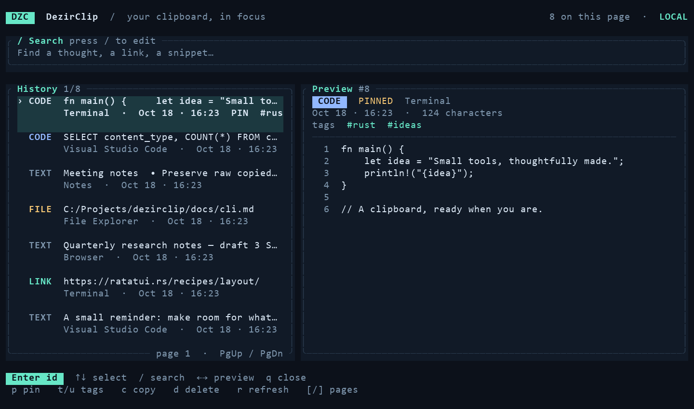

# DezirClip

Windows 和 Linux X11 上的本地剪贴板工作台：保存、搜索、恢复剪贴板历史，也能通过 `dzc` 把同一份数据接入终端、启动器和 Agent。

本项目派生自 [jimuzhe/tiez-clipboard](https://github.com/jimuzhe/tiez-clipboard)，保留本地桌面能力，移除 macOS 与云同步等网络功能，并加入 Linux X11 支持、自定义 CSS 主题和 WebView 内存管理。当前迭代重点是内容保真、捕获可靠性和 CLI 生态。

[下载发布版本](https://github.com/qiyuanhuakai/dezirclip/releases) · [CLI 文档](./docs/cli.md) · [终端与 MCP 集成](./integrations/README.md) · [Linux 安装指南](./docs/LINUX_INSTALL.md) · [English](#english)

## 安装

需要图形界面时，从 Releases 下载 Windows 安装包或 Linux deb/AppImage/rpm。仅使用脚本、SSH 或终端工具时，可下载独立 `dzc`，不必运行桌面主程序。

| 独立 CLI 压缩包 | 平台 |
| --- | --- |
| `dzc-VERSION-windows-x86_64.zip` | Windows x64 |
| `dzc-VERSION-windows-aarch64.zip` | Windows ARM64 |
| `dzc-VERSION-linux-x86_64.tar.gz` | Linux x64 |
| `dzc-VERSION-linux-aarch64.tar.gz` | Linux ARM64 |

`VERSION` 对应发布版本号。每个独立压缩包包含真正的 `dzc` 二进制、许可证、说明、完整的集成运行文件目录 `integrations/` 和 `skills/dzc-cli/`，不含开发测试文件；对应 `.sha256` 文件用于校验下载。

本轮兼容性改造后的 CI 制品和后续独立发布包附带 `COMPATIBILITY.json`，记录真实二进制的校验值和动态依赖。Linux CLI 在 Ubuntu 22.04 中构建，基线为 glibc 2.35+，并在 Ubuntu 22.04、Debian 12 中验证实际压缩包；仍需要系统的 `libdbus-1-3`、`libgcc-s1`。Windows 独立 CLI 静态链接 MSVC 运行库，无需另装 Visual C++ 运行库或 WebView2。桌面安装包保持自己的图形及运行库要求，详见 [CLI 安装说明](./docs/dzc-standalone.md)和 [Linux 指南](./docs/LINUX_INSTALL.md)。

已发布的 `v0.1.20-alpha.1` / `alpha.2` 附件保持原样：旧 Linux 包仍按发布说明要求 glibc 2.39+，旧 Windows 包缺少 `VCRUNTIME140.dll` 时需安装匹配架构的 [Microsoft Visual C++ v14 运行库](https://learn.microsoft.com/en-us/cpp/windows/latest-supported-vc-redist)：[x64](https://aka.ms/vc14/vc_redist.x64.exe) / [ARM64](https://aka.ms/vc14/vc_redist.arm64.exe)。

`dzc pick/tui/mcp` 与 Shell 初始化入口自 `v0.1.20-alpha.2` 起提供。较旧发布包请使用各自随包说明；运行 `dzc --help` 可确认当前二进制支持的命令。

解压后将二进制目录加入 `PATH`；也可在适配器中用 `DZC_BIN` 指定完整路径。例如：

```powershell
# Windows，按实际解压目录修改；仅影响当前会话
$env:Path = "C:\Tools\dzc;$env:Path"
$env:DZC_BIN = 'C:\Tools\dzc\dzc.exe'
dzc --version
```

```bash
# Linux，假设解压到 ~/tools/dzc
export PATH="$HOME/tools/dzc:$PATH"
export DZC_BIN="$HOME/tools/dzc/dzc"
dzc --version
```

桌面安装也附带 `dzc`，可在设置中查看实际路径。同一宿主机用户环境中的普通独立 CLI 默认共享历史；Flatpak 沙箱默认目录独立，AppImage 挂载路径也不适合永久加入 `PATH`。具体用法见 [CLI 安装说明](./docs/cli.md#安装与路径)。更换机器不会自动获得另一台机器的历史，路径覆盖与可携式安装的区别见 [数据库路径说明](./docs/cli.md#数据库路径与退出码)。

## 桌面端能做什么

- 本地 SQLite 历史，支持文本、富文本、图片、文件、代码、URL、标签和置顶。
- 快速粘贴浮层、多组快捷键、区域截图、OCR 图片搜索、文本转换和备份导入导出。
- 六套内置主题，可导入导出完整 CSS 主题包；隐藏窗口时降低 WebView 内存占用，可配置空闲销毁与 GPU 行为。
- 新捕获的文本保留首尾空白和原始换行，预览与搜索单独规范化；X11 优先使用 XFixes，必要时回退到包含图片的轮询。
- “设置 → 剪贴板设置 → 不记录这些应用”可排除后续来源应用捕获，每行一个完整应用名、可执行文件名或路径，忽略大小写，可省略 `.exe`，离开输入框后生效。已有历史不受影响，无法识别的来源不能可靠排除。

复制内容后，用配置的全局快捷键打开历史。Quick Paste 默认快捷键为 `Ctrl+Shift+V`，用 ↑/↓ 选择、Enter 粘贴、Esc 关闭。捕获需要主程序运行；仅打开 CLI 不会启动后台桌面监听。

当前桌面支持 Windows 和 Linux X11。完整 Wayland 支持暂缓；OSC52 文本复制属于终端能力，不代表 Wayland 后台监听、全局快捷键和自动粘贴已适配。项目不提供云同步。

## 标签与自定义主题

标签管理器使用主页行卡片，支持复杂/简洁模式、悬浮操作和右键菜单；宽窗口显示设置页式侧栏，低于设置页相同的 560px 切换点时，从当前标签名展开带搜索和创建入口的下拉栏，复用各主题的原生菜单样式。标签与内容均虚拟化，滚动自动翻页。标签页始终显示内容，包括敏感条目，不提供隐藏开关。点击“管理”清单图标可多选、跨页全选当前搜索结果并确认批量删除内容，标签本身保留。移除普通标签保留记录，编辑时读取完整正文。隐私保护关闭时可确认删除「密码」「sensitive」标签及其全部内容；重新开启时恢复系统标签，已删内容不会恢复。

设置的「外观」只提供内置主题选择和文件导入。导入包包含完整 CSS，可定义材质、形状、布局、阴影与控件状态，禁止外部资源。详见[主题指南](./docs/THEMES.md)，Agent 可使用 [dezirclip-theme Skill](./skills/dezirclip-theme/SKILL.md) 编写主题；也可从[森林示例](./skills/dezirclip-theme/assets/forest.theme.json)开始。

改造的测量范围、静态 CSS 审计和验证结果见[标签与主题性能记录](./docs/tag-theme-performance.md)。

## CLI：历史与当前剪贴板

```bash
dzc list --metadata --json --exclude-sensitive
dzc search "project" --ids
dzc get 142 --raw
dzc copy 142 --quiet
dzc clipboard read
printf 'hello\n' | dzc clipboard write -
dzc add "常用片段"
dzc tag add 142 work
dzc export backup.json
```

`list/search/get/add` 操作历史数据库，GUI 关闭时也能工作；`clipboard read/write` 操作当前系统剪贴板。`copy ID` 按记录格式恢复文本、HTML、图片或文件，不自动向应用发送粘贴按键。Windows/X11 原生读写无需 `xclip`、`xsel` 或 `wl-copy`；X11 写入后由轻量后台进程持有内容，被其他应用替换后退出。原生剪贴板需要可访问的桌面会话，Linux GUI 自动粘贴按键仍依赖 `xdotool`。

`--raw` 不补换行；`--mime image/png` 可输出图片字节；列表/搜索支持 JSON、元数据、TSV 和过滤后分页。`--exclude-sensitive` 在解密前排除已标记敏感或加密记录，无法识别所有未标记的私人内容。备份内嵌图片原始字节；文件列表、视频及 HTML 外链资源仍引用原文件。完整参数见 [CLI 文档](./docs/cli.md)。

## 选择与终端管理

安装 `dzc` 后直接运行：

```bash
dzc pick                         # 内置选择界面，Enter 复制
dzc tui                          # 搜索、预览、标签、置顶及确认后删除
dzc pick --query meeting --kind text
dzc pick --action print           # 输出原始文本，保留换行
```

`pick` 默认使用内置终端界面。已安装其他选择器时，也可选择：

```bash
dzc pick --backend fzf
dzc pick --backend dmenu
dzc pick --backend rofi
```

原生界面无需 Python、curses 或外部选择器。↑/↓ 选择，`/` 搜索，Enter 执行动作，`q` 或 Esc 退出；`p` 置顶，`t/u` 添加/移除标签，`d` 输入 `yes` 后删除。默认动作是复制；`--action print/id/insert/osc52` 可输出正文、ID、Shell 文本或发送到终端剪贴板。界面只绘制到控制终端，重定向输出可得到纯数据。

新版默认界面使用 [Ratatui](https://ratatui.rs/)：历史与预览分栏、内容类型与标签、完整行选中状态、行号和滚动条；窄终端自动改为上下布局。支持终端尺寸变化与 `NO_COLOR`。下图来自真实终端输出，使用虚构示例记录：



## Shell：按 Ctrl-G 插入当前输入行

按当前 Shell 选择一行加载；常用时将该行放入自己的启动配置：

```bash
eval "$(dzc bash)"        # Bash 5+
eval "$(dzc zsh)"         # Zsh
dzc fish | source        # Fish 3.4+
```

```powershell
dzc pwsh | Out-String | Invoke-Expression  # PowerShell 7 + PSReadLine
```

Nushell 0.116+ 使用其用户自动加载目录：

```nu
dzc nu --install ($nu.user-autoload-dirs.0 | path join dzc.nu)
# 重新打开 Nushell 后按 Ctrl-G
```

`dzc nu` 也可仅打印初始化脚本。`--install` 只写入明确指定的新 `.nu` 文件；遇到不同的已有文件会拒绝覆盖。其他 Shell 命令只打印脚本，不修改启动配置。

Ctrl-G 默认打开内置 TUI，把选中的内容插入编辑缓冲区，保留多行和末尾换行，等待用户确认。可用 `DZC_PICKER=fzf/rofi/dmenu` 切换外部选择器，用 `DZC_BIN` 指定其他 CLI。选中内容不会被当作脚本执行，取消不会改动输入行。完整说明见 [集成指南](./integrations/README.md#shell-编辑缓冲区集成)。

## SSH：把远程文本复制到本地

在支持并允许 OSC52 的本地终端连接远程主机：

```bash
ssh -t user@server
# 以下在远程执行
dzc pick --action osc52
dzc copy 142 --target osc52
printf 'remote note\n' | dzc clipboard write - --target osc52
```

OSC52 无需远程 GUI 或 `DISPLAY`，最多发送 100000 个原始 UTF-8 字节，超限报错且不截断。它只写控制终端，stdout 保持为空；不读取本地剪贴板、不自动粘贴或同步历史。成功表示序列已发送，实际写入仍由终端权限和容量决定。单层 tmux 穿透需显式添加 `--osc52-passthrough tmux`，并自行允许 tmux 的 `allow-passthrough`。原生系统剪贴板仍是默认目标。

## 只读 MCP 与 Agent Skill

MCP 客户端直接启动 `dzc mcp`：

```json
{
  "mcpServers": {
    "dezirclip": {
      "command": "/absolute/path/to/dzc",
      "args": ["mcp"]
    }
  }
}
```

Windows 将 `command` 改为实际的 `dzc.exe` 路径。服务通过 stdio 提供 `clipboard_list`、`clipboard_search`、`clipboard_get`，无网络监听。列表和搜索只返回有界元数据；正文需单独读取，敏感标签和加密记录在解密前排除。服务不提供写入、复制、删除或执行工具。

过滤依据是已有敏感标签和加密状态，不能识别所有私人内容；未标记的私人明文仍可被 Agent 读取。只有希望提供给客户端的本地数据库才应配置到 MCP，完整边界见 [数据安全说明](./docs/data-safety.md)。

直接使用 CLI 的 Agent 可安装 [`skills/dzc-cli`](./skills/dzc-cli/)。协议边界、配置和旧适配器兼容说明见 [集成指南](./integrations/README.md)。

## 开发与验证

使用 Node.js 22.12+、项目固定的 pnpm 11.0.9 和稳定版 Rust；Windows 还需 C++ 构建工具与 WebView2，Linux 构建依赖见 [安装指南](./docs/LINUX_INSTALL.md)。

```bash
pnpm install
pnpm run tauri:dev
pnpm run build
pnpm run i18n:check
pnpm run test:unit
cargo test --manifest-path src-tauri/Cargo.toml
python3 -m unittest discover -s integrations/tests -v
python3 -m unittest discover -s scripts/tests -v
pnpm run tauri:build
```

桌面构建产物在 `src-tauri/target/release/bundle/`。只构建 CLI 可运行 `cargo build --manifest-path src-tauri/Cargo.toml --no-default-features --bin dzc --release`，无需编译桌面依赖。分发兼容包使用 Python 3.11+ 的 `scripts/build-standalone-dzc.py --platform windows-x86_64` 等参数构建，再把返回的二进制路径传给 `scripts/package-dzc.py --platform windows-x86_64 --binary 路径`；Linux 构建脚本需要 Docker，在 Ubuntu 22.04 容器中编译、链接。`scripts/verify-dzc-package.py 压缩包路径` 会解压后检查动态依赖、版本和独立进程间的数据持久化。发布流程与安装命令以仓库脚本及对应版本说明为准；旧 roadmap 仅作为历史规划，不是当前功能清单。

## 许可证与来源

DezirClip 使用 GPL-3.0，源自同样使用 GPL-3.0 的 [jimuzhe/tiez-clipboard](https://github.com/jimuzhe/tiez-clipboard)。适用的原始版权和许可证声明予以保留。

## English

The tag manager shares the main history rows, with detailed/compact modes, hover actions, context menus and automatic paged scrolling. Below the settings page's shared 560px breakpoint, the wide sidebar becomes a dropdown under the current tag name, with search and tag creation using each theme's native menu style. Tag management always displays sensitive content and has no visibility toggle. The Manage checklist icon enables selection, selecting all matching entries across unloaded pages, and confirmed batch deletion while keeping the tag. Removing ordinary tags keeps their items. With privacy protection off, confirmed deletion can clear system sensitive tags and their contents; enabling protection recreates the tags. Appearance offers built-in themes and imported full CSS packages with external resources blocked. See the [theme guide](./docs/THEMES.md) and [theme authoring Skill](./skills/dezirclip-theme/SKILL.md).

DezirClip is a local clipboard workspace for Windows and Linux X11, forked from [jimuzhe/tiez-clipboard](https://github.com/jimuzhe/tiez-clipboard). This fork removes macOS and cloud/network features, adds X11 support, custom CSS themes and WebView memory controls, and provides a shared Rust storage core for the GUI and `dzc` CLI. Full Wayland desktop support remains deferred.

Download desktop installers or standalone CLI archives from [Releases](https://github.com/qiyuanhuakai/dezirclip/releases). Standalone archives are named `dzc-VERSION-{windows,linux}-{x86_64,aarch64}` with `.zip` on Windows or `.tar.gz` on Linux; each includes the real CLI, license, matching `integrations/`, and Agent Skill. Check the accompanying `.sha256`. New CI artifacts and future releases include `COMPATIBILITY.json`: Linux CLI builds target glibc 2.35+ using Ubuntu 22.04 and are verified in Ubuntu 22.04 and Debian 12, with system D-Bus/GCC runtime libraries. Published alpha.1/alpha.2 assets remain unchanged with their original requirements, including glibc 2.39+. Keep CLI and adapters on matching versions.

Add the extracted binary directory to `PATH`, or set `DZC_BIN` to its absolute path. History commands work without the GUI; native clipboard access needs an accessible desktop session. Ordinary host installations share the current user's history; Flatpak defaults are sandboxed, and AppImage mount paths are temporary. See the [CLI reference](./docs/cli.md) for stable installation paths, sandbox access and portable data locations. Archives contain all integration runtime files, excluding development tests.

```bash
dzc list --metadata --json --exclude-sensitive
dzc search "project" --ids
dzc get 142 --raw
dzc copy 142 --quiet
dzc clipboard read
printf 'hello\n' | dzc clipboard write -
```

The GUI offers history, tags, pinning, rich text, images, files, OCR search, screenshots, text transforms and themes. Quick Paste defaults to Ctrl+Shift+V; use arrows and Enter to paste, or Esc to close. New captures preserve original whitespace and line endings. X11 uses XFixes with image-aware polling fallback. Source application exclusions block future captures when the source can be identified.

New standalone Windows builds statically link the MSVC runtime and require no extra Visual C++ runtime or WebView2. Older alpha.1/alpha.2 archives may still require the matching architecture's [Microsoft Visual C++ v14 runtime](https://learn.microsoft.com/en-us/cpp/windows/latest-supported-vc-redist). This does not change desktop installer requirements.

The following native entry points are available since `v0.1.20-alpha.2`; check `dzc --help` when using older releases. They require no Python or curses:

```bash
dzc pick                         # built-in selection, Enter copies
dzc tui                          # search, preview and manage history
dzc pick --backend fzf            # optional: fzf / dmenu / rofi
eval "$(dzc bash)"                # Bash 5+ initialization
eval "$(dzc zsh)"                 # Zsh initialization
dzc fish | source                # Fish initialization
```

PowerShell 7: `dzc pwsh | Out-String | Invoke-Expression`. Nushell 0.116+: `dzc nu --install ($nu.user-autoload-dirs.0 | path join dzc.nu)`, then restart Nu. Ctrl-G uses the built-in TUI and inserts literal text into the editing buffer, preserving newlines and waiting for confirmation. Set `DZC_PICKER` to fzf/rofi/dmenu to use an external selector. Shell output commands do not modify startup files; the explicit Nu installer refuses conflicting files.

The redesigned default TUI uses Ratatui, with history/preview panels, type badges, tags, line numbers and a responsive stacked layout on narrow terminals. It respects `NO_COLOR`; the screenshot above shows actual terminal output with synthetic records.

For SSH, use `dzc pick --action osc52` or `dzc copy ID --target osc52`. Text is written to the controlling terminal, capped at 100000 original UTF-8 bytes, without readback or history sync; success means sent. Single-layer tmux passthrough is explicit. The terminal must support and permit OSC52.

Configure MCP with the absolute `dzc` path as `command` and `["mcp"]` as `args`. It provides bounded, read-only list/search/get tools over stdio and excludes sensitive/encrypted records before decoding. Untagged private plaintext remains readable; this filter cannot identify all private content. See [data safety](./docs/data-safety.md), the [integration guide](./integrations/README.md), or install the [Agent Skill](./skills/dzc-cli/) for direct CLI use.

Build with the commands in the development section above. DezirClip and its upstream are licensed under GPL-3.0; applicable original copyright and license notices are retained.
