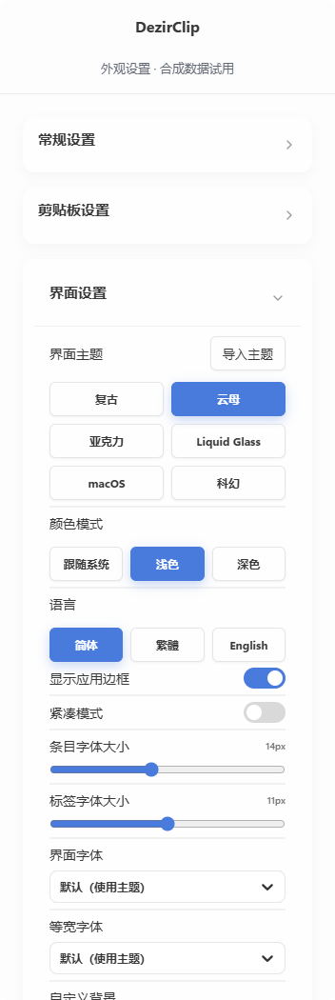

# 主题选择与导入

外观设置只提供六套内置主题和主题文件导入。应用不提供主题编辑器。完整主题涉及材质、形状、布局、阴影、字体和控件状态，不能用调色板代替。

「导入主题」读取本地 `.theme.json`，成功后选中该主题。「导出主题」生成可分享的同格式文件。「删除主题」删除导入文件的本地副本；正在使用时切回云母。内置主题不会被导入文件覆盖。

可以先导入[森林示例](../skills/dezirclip-theme/assets/forest.theme.json)。它包含亮暗模式、渐变标题栏、非对称卡片形状、阴影、表单和选中/悬停/焦点状态。相同 ID 的导入会报错，不静默覆盖；更新时使用新 ID，或先导出备份并删除旧的导入主题。



## 文件格式

主题包是 UTF-8 JSON，最多 256 KiB，最多保存 32 个。CSS 随包保存，无需解压图片或安装字体。

| 字段 | 约定 |
| --- | --- |
| `format` / `version` | `"dezirclip-theme"` / `1` |
| `id` | 1–48 个小写字母、数字或连字符；连字符不能开头、结尾或连续出现 |
| `name` | 1–80 个可打印 Unicode 字符 |
| `author` / `description` | 可选，分别最多 80 / 240 字符 |
| `base` | `mica`、`acrylic`、`liquid-glass`、`retro`、`macos`、`scifi`，选择原生窗口材质 |
| `css` | 完整的非空 CSS 样式表字符串 |

`base` 不会把对应内置主题的视觉规则叠在导入样式上。导入主题负责自己的视觉设计，仍可使用共享样式变量。`macos` 只是已有视觉主题名称，项目仍支持 Windows 和 Linux。

用 JSON 序列化程序生成文件，避免 CSS 的引号和换行造成错误。例如：

```json
{
  "format": "dezirclip-theme",
  "version": 1,
  "id": "my-theme",
  "name": "My theme",
  "base": "mica",
  "css": ":root.theme-custom { --dc-radius: 12px; }\n.theme-custom .history-item { border-radius: 4px 12px; }"
}
```

以上仅演示文件结构；完整主题应同时检查亮暗模式、材质和所有控件状态。

## CSS 契约

运行时给 `html`、`body` 添加 `.theme-custom`，并保留 `.light-mode` 或 `.dark-mode`。使用 `:root.theme-custom` 定义变量，`.theme-custom.dark-mode` 提供暗色值；组件规则以 `.theme-custom` 为作用域。切回内置主题时移除导入样式表。

公共 token 是共享控件的语义接口，不限制主题只能修改颜色：

| 用途 | token |
| --- | --- |
| 表面 | `--dc-surface-window`、`--dc-surface-panel`、`--dc-surface-raised`、`--dc-surface-input`、`--dc-surface-hover`、`--dc-surface-active` |
| 文字 | `--dc-text-primary`、`--dc-text-secondary`、`--dc-text-muted`、`--dc-text-on-accent` |
| 边框 | `--dc-border`、`--dc-border-strong` |
| 强调 | `--dc-accent`、`--dc-accent-hover`、`--dc-accent-soft` |
| 状态 | `--dc-success`、`--dc-warning`、`--dc-danger`、`--dc-info` |
| 圆角 | `--dc-radius`，CSS 长度 |

旧控件继续使用 `--bg-window`、`--text-primary`、`--border-dark`、`--accent-color`、`--icon-btn-*` 等变量。示例给出映射；主题可继续定义材质、渐变、阴影、边框、排版、布局与状态。透明度使用现有的 `--surface-opacity`；标签独立颜色属于数据，应保留 `data-tag` 元素的用户配色。

禁止外部资源。解析器拒绝 `@import`、`@font-face`、`@namespace`、`@document`，以及 `url()`、`src()`、`image-set()` 和对应前缀形式；转义与注释不能绕过。远程、本地和 data URL 均不接受。渐变、CSS 图形、阴影、变量、`calc()`、媒体/容器规则和状态选择器可正常使用。

导入主题只改变界面，不改变内置主题文件、剪贴板内容和数据库结构。CSS 会在前后端分别解析验证；未知元数据、超限或资源引用会被拒绝。

## 给 Agent 编写主题

仓库提供 [dezirclip-theme Skill](../skills/dezirclip-theme/SKILL.md) 和完整示例。将该目录复制到 Codex 的 skills 目录，或让 Agent 直接阅读。用相同的原生解析器校验文件，无需导入或打开历史数据库：

```text
dzc theme validate /absolute/path/to/my.theme.json --json
```

此命令在本次改造后的版本提供。旧 CLI 请使用匹配的新发布包或源码构建。校验通过不等于视觉质量合格，仍需检查历史、标签、设置、菜单、确认框、Quick Paste、窄窗口以及亮暗模式。

公共变量及派生材质位于 `src/styles/tokens/semantic.tokens.css`；内置主题保持各自的材质/装饰，新的控件消费共享契约。优先完善共享控件变量，不继续为每个新控件复制六套覆盖规则。性能和 `!important` 审计范围见[验证记录](./tag-theme-performance.md)。
