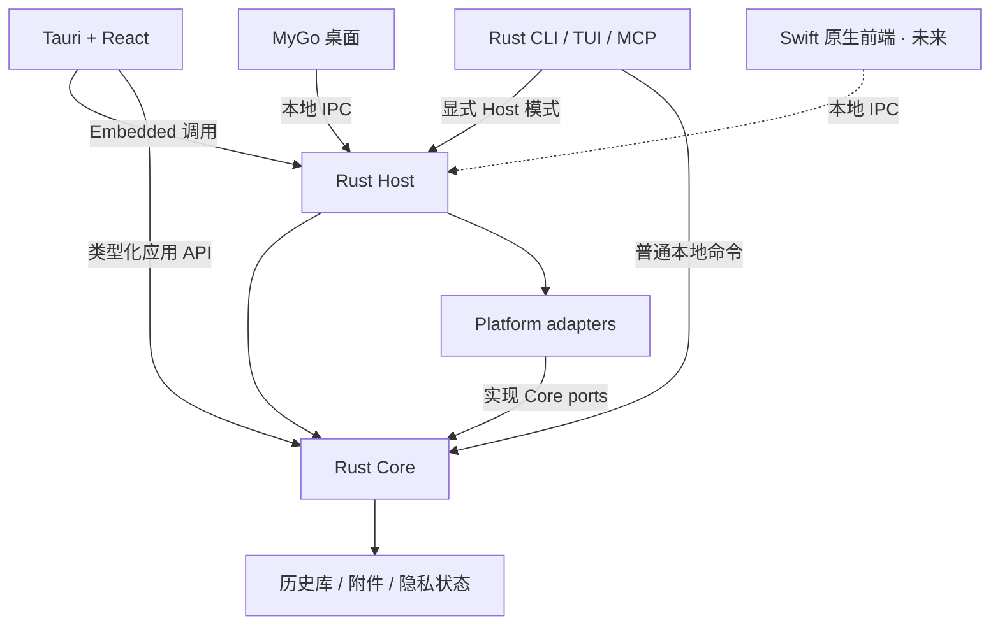
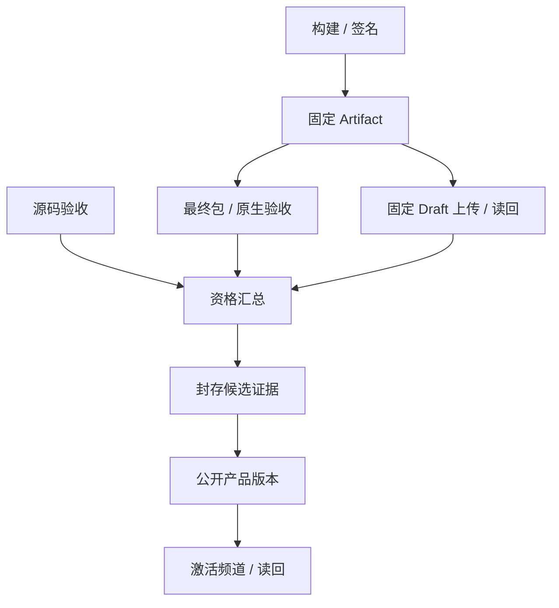

# DezirClip 架构整理与冗余清理 Spec

**编号：** DZC-ARCH-001

**版本：** 1.2 Final

**日期：** 2026-11-20（北京时间）

**状态：** 最终实施规范；架构、测试/CI/Release 与可行性交叉审查完成；代码迁移尚未执行

**实施进度：** 上述状态及第 13 章记录规范交付时的审查基线；归档后的代码变更和验证状态见 [架构整理实施记录](../architecture-implementation.md)。

**适用仓库：** https://github.com/qiyuanhuakai/dezirclip

**审查基线：** `1f1641a0455bfcdbc72b4ba70a24d3cb810887a9`，`0.2.0-beta.4`

**建议归档位置：** `docs/specs/architecture-simplification.md`

**设计输入：** 缩减重复规则和维护复杂度，保持当前功能，为未来 macOS Swift 原生前端准备清晰接口；同步整理 CI、Release 与测试。
**版本关系：** 本版完整替代 v1.0/v1.1；以本版的接口前提、实施依赖与验收门槛为准。
**最终审查补充：** 明确主题事务结果、数据库初始化与共享句柄、early probe 路径差异、CLI 单一打包登记、Go wrapper/资源边界、设置上下文默认值、跨语言 codec、发布门槛闭环与 macOS M0 实证。第 13 章记录本次实际验证及未验证范围。

> 本 spec 的主要决策是：保留 Rust Core，完成已有分层；将 CLI 从 Tauri 包中独立；让多种前端共享业务契约、设置与设计资产；合并重复的工具职责；将 macOS 系统适配与 Swift UI 分阶段实现。完成标准是减少独立维护的规则、越层访问和构建耦合，不以仓库总行数或语言数量作为唯一目标。

## 0. 最终决策与阅读方式

**结论：该项目适合沿既有分层渐进整理。主要收益来自取消重复职责、关闭越层访问和建立可信的构建/验收路径。没有证据支持整批替换 Python、重写 Rust Core 或同时建设多个 macOS 运行架构。**

本文的“必须”“验收”“完成”描述后续实施要求；“当前”“已确认”描述固定基线的事实；第 13 章单独记录本次审查真正执行的检查。最终版规范完成不等于产品迁移、原生验收或发布已经完成。

| 决策 | 最终选择 | 先行条件 / 后置范围 |
|---|---|---|
| D01 语言与核心 | 保留 Rust Core、Go/MyGo、React/TS 与开发工具 Python | 性能改动须有同口径测量；不按后缀或总行数删除 |
| D02 Core 收口 | 沿既有 HistoryService/领域 API 补小接口，复用同一连接、cache 与 session | 主题结果、初始化政策先等价；最后退出 legacy，不新增总管式 CoreRuntime |
| D03 CLI / Service | 新增唯一 `dzc-cli` crate，Service bin 归已有 crate | CLI 依赖闭包与 Tauri sidecar 登记一起切换；GUI 全部 legacy 清零不是前置 |
| D04 多前端共享 | 共享静态元数据、wire 契约和资产；各前端保留视图状态 | settings 允许没有持久化默认值；TS 先覆盖实际消费者，Swift 生成器后置 M2 |
| D05 Go 重整 | 用小 application 接口、显式 bridge wrapper 与构造注入逐片迁移 | 保留绑定名称、方法集合、资源与链接参数；首片通过后再增加内部包 |
| D06 源码发布准入 | 首版在当前 Release 内调用现有 ci.yml 的 source-acceptance 模式 | 只等待必需子 jobs 完成；跨 run 自动寻找/拼接证据后置 |
| D07 候选与恢复 | 一份冻结的候选证据；产品资产与单个证据附件有严格、不同的契约 | workflow、publisher policy、资产目录规则同 PR 切换；阶段日志不覆盖冻结证据 |
| D08 原生验收 | 每种证据明确是 static、实际客户端、原生或最终安装包 | Windows ARM64 保留当前 cross-build 验证级别并公开限制；不虚构原生通过 |
| D09 Swift / macOS | 先做 UDS + Rust helper 的真实 M0 切片，再确定一个首发拓扑 | M0 必须包含系统操作与真实身份；未通过前不创建完整 SDK/空 CI，也不承诺 macOS 发行 |

优先处理 R1/R3/R4 的业务与构建边界，以及 C1/C2/C5/C6 的真实执行和发布资格。大文件机械拆分、无消费者的公共抽象、全面生成 Swift 类型、跨 run 自动验收复用、FFI 和样式池压缩都不阻塞本轮。

实施者可先读第 9 章任务与依赖、第 13 章可行性结论，再进入负责领域的详细条款。每个条款都应落实为可核查的消费者迁移或退出条件，不能只交付新目录。

## 1. 范围、约束与成功标准

### 1.1 本轮交付

本 spec 规定以下后续实施范围；本次交付为审查结论与最终规范：

1. 建立可复算的代码分类、运行入口和依赖基线。
2. 收紧 Core 对外 API，迁移现有桌面对数据库内部实现的直接依赖。
3. 独立构建 `dzc` CLI，将 `dzc-service` 二进制入口归入已有 Service crate。
4. 合并设置、主题标识、协议类型和公共资产的重复维护来源。
5. 整理 Go 桌面、React 状态和客户端适配器，使界面实现与业务规则分离。
6. 合并构建、打包和测试脚本的共同职责，退役已经失去当前用途的兼容入口。
7. 明确 Darwin 平台接入、Swift 客户端和 macOS 分发的后续实施契约。
8. 修复 CI 请求/执行范围、测试未执行状态及当前发布门槛的脱节，按 C0–C7 清理重复与失效路径。

本轮主要修改内部结构。协议、默认设置、数据库格式、产品功能的有意变化，应另列行为变更，并有独立验证。

### 1.2 保持的产品范围

| 项目 | 本轮要求 |
|---|---|
| Tauri + React 桌面 | 保留；默认 Embedded 路径继续通过进程内 API 工作 |
| MyGo 桌面 | 保留现有 Go UI + Rust Service 运行方式，以及现有 React WebView fallback |
| CLI / TUI / MCP / shell | 保留现有命令、输出、退出码、权限和交互语义 |
| Windows / Linux | 保持当前发行目标、安装方式及原生功能；Wayland 继续按已有能力声明处理 |
| 功能与视觉 | 保留当前历史、搜索、标签、队列、隐私、备份、设置、六种主题和三种语言 |
| 存储 | 保持已有 schema、迁移链、密文、数据目录重定向、portable 语义 |
| 发行 | 保留签名更新、版本身份、目标架构、ABI、安装和升级验证 |
| 网络 | 不新增云同步或远程 Host；继续已有签名更新的明确例外 |
| macOS / Swift | 本轮完成接入准备；真实支持按第 8 章单独验收 |

当前 `AGENTS.md` 的架构介绍仍包含早期 Tauri 单桌面描述。R0 必须更新事实性内容，并将旧的“禁止 macOS”条款调整为：“当前发行范围为 Windows/Linux；允许按本 spec 整理未来 Swift/macOS 接口；macOS 支持需要独立平台验收。”这是落实本次用户的新方向，不扩展为其它未要求的平台重写。[S01] [S02]

### 1.3 明确不开展的工作

本轮不整体改写为 Go、Rust 或 Swift，不引入微服务、插件框架、全局状态管理框架或新的通用开发平台。除独立 CLI 外，默认不新增 Rust crate。不把所有调用强制改为 IPC，不为未来 Swift 先建立空 crate、空页面或空能力实现。

性能优化使用第 10 章的测量与独立提交流程。目录迁移不与数据库重设计、加密格式变更、异步状态机改写合并。

### 1.4 完成指标

| 指标 | 目标及判定方式 |
|---|---|
| 业务权威来源 | 每项历史、隐私、设置校验和持久化规则有一个 Core 实现；前端只转换输入、显示结果 |
| 数据库边界 | 产品代码中，Core 外没有直接查询或修改历史库的路径；测试 fixture 不按依赖名误判 |
| 旧桥接 | `legacy-bridge`、旧 repository 重导出及产品用 `from_legacy_*` 调用全部退出 |
| CLI 构建 | 指定 CLI package 可独立构建，不需要 Tauri/WebView、Node、前端产物或 GUI 初始化 |
| 共享元数据 | 已覆盖的设置持久化默认值/静态元数据、主题 ID/能力、wire DTO 与 emoji 作者源各只有一处；上下文解析行为有明确归属 |
| Go 分层 | `cmd/dzc-desktop` 负责装配；业务编排和窗口实现各有明确归属，无内部循环依赖 |
| React 适配 | 业务调用为有类型的接口；底层适配器不读取 UI 的全局隐私状态 |
| 工具清理 | 重复的二进制检查、打包集合、测试生命周期实现由共享模块替代；原实现随迁移删除 |
| macOS 准备 | 协议和能力不依赖 Tauri/MyGo 类型；Linux 特有实现不再伪装成所有非 Windows 平台 |
| 验证 | 当前支持面保持；迁移 PR 有对应行为证据，最终候选有真实平台及产物验证；required skip/取消不算通过 |
| CI / Release | 现有 workflows 内收敛模式；源码准入与最终包验证绑定候选，发布恢复覆盖有限中断状态 |
| 维护量 | 分开记录手写产品、工具、测试、生成物、历史材料；只对实际取消的维护职责宣称减量 |

不承诺“删除 30%”或“性能提升两倍”。这些指标必须来自实施后的同口径测量。

## 2. 当前规模与优先处理的问题

### 2.1 统计口径与基线

以下为固定 commit 下 `git ls-files` 跟踪文件的物理行数，包含注释、空行和内联测试；不展开 ZIP，不统计依赖安装目录。它们不是生产逻辑行数。

| 类别 | 文件数 | 物理行数 |
|---|---:|---:|
| Rust | 329 | 98,147 |
| Go | 199 | 27,229 |
| Python | 118 | 28,391 |
| JSON | 41 | 50,717 |
| TypeScript | 214 | 16,290 |
| TSX | 95 | 15,557 |
| MJS | 44 | 9,560 |
| JS | 1 | 108 |

Rust 的 98,147 行分布为 Core 29,925、Platform 22,980、Host 7,585、Protocol 2,579、Service 920、Tauri 包 33,193，以及脚本下 Rust fixture 965 行。大文件中也包含大量内联测试；例如 `clipboard_repo.rs` 为 4,073 行，测试从约 2,418 行开始。不能将整个文件等同于四千行生产逻辑。

Go 的 `*_test.go` 为 54 个文件、5,104 行。Python 中只有 7 个旧可选集成实现、合计 664 行；其它 111 个文件承担开发、测试、性能、发布和历史复算职责。

### 2.2 JSON 的实际构成

| 类别 | 文件数 | 行数 | 占比 |
|---|---:|---:|---:|
| 生成的主题、协议镜像、翻译 | 5 | 37,583 | 74.1% |
| 协议源 schema | 19 | 6,588 | 13.0% |
| 历史证据 | 3 | 5,206 | 10.3% |
| 测试 fixture | 2 | 731 | 1.4% |
| 其它配置和资产 | 12 | 609 | 1.2% |

最大的两类是生成的 `builtin-widget-styles.json`（21,019 行）和 Rust/Go 各一份协议 schema 镜像（各 7,545 行）。它们已有生成器和实际消费者。保留独立包所需的镜像、统一源与检查即可；直接删除、压成一行或移出目录不能视为业务简化。[S03] [S04] [S05]

### 2.3 需要优先解决的结构性问题

| 发现 | 当前证据 | 影响 | 优先级 |
|---|---|---|---|
| Core 已拆分，但桌面仍访问内部数据库 | `legacy-bridge`、公开 `DbState`、Tauri theme/setup 等直接锁连接 | API 边界不完整，增加第三前端时容易复制规则 | P0 |
| CLI 仍归属 Tauri package | `src-tauri/src/cli`、多个 bin、`cli_infrastructure.rs` 路径拼接 | 非 GUI 构建仍需理解桌面包的 feature 与构建约定 | P0 |
| 设置和主题规则多处手工列举 | Core、Go library、React 默认状态、主题生成脚本 | 每次增改需跨语言同步 | P0 |
| Go 桌面入口包过大 | `cmd/dzc-desktop` 下 128 个 Go 文件处于同一个 package main | 服务调用、窗口状态、平台行为难以单独推理 | P1 |
| React 适配层形成状态耦合 | `desktopInvoke` → MyGo commands → `privacySession` → `desktopInvoke` | 连接权限和 UI 状态互相影响 | P1 |
| 共享 UI 包混入产品 shell 样式 | 全局 body/#root、窗口边框、产品设置样式 | 复用 UI 时附带 DezirClip 的页面行为 | P1 |
| 资产方向倒置 | React 从 Go desktop 目录导入 emoji 数据 | 新前端被迫依赖另一前端的目录 | P1 |
| 工具重复承担相同职责 | 多份 PE/ELF 检查、组件清单、进程生命周期 | 修复需要多处同步 | P1 |
| 功能测试靠源码字符串派生性能版本 | `windows-performance/derive.py` | 业务代码改动触发派生器及其证明测试维护 | P1 |
| 旧发布恢复路径常驻主流程 | 固定 alpha.2 / alpha.9 的重放入口 | 增加当前 CI 和发布分支复杂度 | P2 |
| 非 Windows 分支隐含 Linux | IPC、密钥、进程及文件代码 | macOS 接入不能仅添加 Swift UI | P0 设计 / P1 整理 |

已有 Core → Protocol、Platform → Core/Protocol、Host → Core/Platform/Protocol 的方向基本可用。优先完成这套设计，不再建立平行的“新 Core”。[S06] [S07] [S08] [S09]

## 3. 目标架构与目录归属

### 3.1 运行关系

下图表示主要调用关系；具体编译依赖由下一节约束。Swift 路径属于未来阶段。



普通 CLI 仍可本地打开 Core；显式 Host 模式保持显式，不在失败时偷偷切换数据访问路径。Tauri Embedded 不因 Swift 的加入增加不必要的服务进程。MyGo 和未来 Swift 复用 Host 的连接、授权、快照和事件契约。[S02]

### 3.2 组件职责与允许依赖

| 组件 | 唯一职责 | 允许依赖 | 不应包含 |
|---|---|---|---|
| `dzc-protocol` | 共享 DTO、错误、能力与 wire 契约 | 序列化及校验依赖 | UI 状态、数据库、平台调用 |
| `dzc-core` | 历史、设置规则、隐私策略、附件/备份规则、持久化、应用 API、ports | Protocol；已有基础库 | Tauri、Go/Swift 类型、窗口生命周期 |
| `dzc-platform` | 原生剪贴板、粘贴、权限、系统身份、本地传输、密钥及文件适配 | Core 的受控公开 API、ports、provider，以及 Protocol | 产品 UI、repository/数据库连接、历史 SQL、另一套隐私规则 |
| `dzc-host` | Embedded/Service 编排、授权会话、capture owner、事件、调度 | Core、Platform、Protocol | 界面组件、客户端缓存、未经认证的权限声明 |
| `dzc-service` | 显式服务的启动、退出、参数和运行装配 | Host 及必要配置类型 | 独立业务实现 |
| `dzc-cli`（新增） | CLI/TUI/MCP/shell 的输入输出和命令编排 | Core、Host、Platform、Protocol；必要的 service 控制入口 | Tauri、WebView、React |
| `src-tauri` | Tauri 命令适配、窗口、托盘、热键接线、桌面装配 | 以上 API 与 Tauri 依赖 | repository 和历史 SQL |
| `clients/go` | wire、认证连接、超时、快照、事件状态契约 | Protocol/平台 transport 适配 | Go UI 控件、桌面窗口和 UI 全局状态 |
| `clients/ts`（轻量新增） | 生成的 wire DTO 与纯客户端契约 | 协议类型 | React、Tauri 生命周期；本轮不独立发布 npm 包 |
| `frontends/dzc-surface` | MyGo 产品 UI 和窗口装配 | Go SDK、UI 包 | 重复 Core 规则 |
| `src` | React 产品 UI、view model、桌面 ports 的两种适配 | UI 包、生成类型 | 直接查库、原始密钥、隐式权限升级 |
| `clients/swift`（未来） | Swift 协议、transport、session | Foundation/所需原生接口 | SwiftUI 业务视图、历史 SQL |
| `frontends/dzc-macos`（未来） | SwiftUI/AppKit 窗口与原生交互 | Swift SDK、平台呈现代码 | Go GUI、CSS 渲染器、另一套 Core |

Core 对 Platform 的使用通过既有 ports / provider 注入，避免反向 crate 依赖。Platform 可以实现 Core trait；不能使 Core 引用具体 Platform 模块。

### 3.3 目录策略

本轮只引入有明确消费者的新目录：

| 目标位置 | 来源 / 内容 |
|---|---|
| `crates/dzc-cli` | 现有 CLI、TUI、MCP、shell；保持可执行文件名 `dzc` |
| `crates/dzc-service/src/main.rs` | 从 Tauri 包移出 service bin 装配 |
| `protocol/settings.catalog.json` | 共享设置元数据；不等于开放任意 setting 的 wire API |
| `design/themes.json` | 主题 ID、名称 key、CSS 入口和能力元数据 |
| `assets/catalogs/emoji.json` | emoji 唯一作者源 |
| `clients/ts/protocol` | 当前 React/MyGo bridge 使用的生成 wire 类型 |
| `frontends/dzc-surface/internal/desktop/*` | 同一个 Go module 内拆分职责 |
| `scripts/dzc_tools/*` | 少量被实际复用的 Python 工具模块 |

不为美观把全部已有目录改名为 `apps`，不改变 Go module/import path。`clients/swift`、`frontends/dzc-macos` 在后续 M 阶段有实现时创建。

## 4. 数据、业务与协议边界

### 4.1 完成 Core API 收口

优先使用已有 `HistoryService`、`BackupService`、`SessionHistoryStore` 及领域 API。每次只补一个实际缺失能力，不新增承载窗口、Host、数据库、设置和维护任务的总管式 facade。

**R1 首片：自定义主题。** 当前 GUI 需要完整主题列表，以及导入/删除所得的完整库快照；现有 Core API 主要返回 ID 列表、单主题或删除 bool，尚不等价。底层 repository 已在事务中获得完整结果；删除活动主题与持久化 fallback 也已经同属一个事务。[S10] [S11] [V01]

因此 R1 必须先在现有 themes 实现增加：

- 一次读取完整主题列表的受控 API；
- 小型 mutation outcome：本次提交所得完整列表、保存的主题或 active-reset 状态；Host 现有返回值可从结果投影；
- GUI 所需的有效 base theme 查询，保持缺失/损坏时原有 fallback。

不得用“IDs + N 次 get”拼装快照，也不得把删除与持久化 fallback 拆开。Core 不接收 Tauri callback，GUI 继续负责 `custom-themes-changed`、窗口与 `SettingsState` 更新。GUI 适配层须串行化自身主题 mutation 的 commit→publish 段，避免并发调用在释放数据库锁后倒序发布旧快照；这一窄协调只保护主题操作，不替代已有窗口生命周期原子协议。保留原命令名、参数、错误与事件契约；任何跨入口新事件语义另列行为变更。

过渡期从 `DbState.history_service()` 取得共享 handle，或在装配时托管它的 clone。该入口复用已有 repository/cache；各 command 不重新 `HistoryService::open`，也不逐个 `from_legacy_connection` 构造独立 repository。Embedded Host 与 GUI 继续使用同一个 RAM session。[V02] [V03]

R1 的最小行为验证包括：mutation outcome 对应该次提交；活动主题删除时列表与选择同时改变；连续或并发 GUI mutation 不发布倒序快照；导入/导出失败、有效 base theme 与窗口 fallback 保持。

后续按设置、历史/标签、备份/数据管理、维护任务迁移。`sensitive_align.rs` 的 SQL 循环移到 Core 内，保留批次 200、游标、授权、加密失败处理与完成标记；它不是无用迁移代码。

**R6 最后切换构造与初始化。** 当前 GUI initializer 显式设置 WAL、`synchronous=NORMAL`、`auto_vacuum=FULL`，检查 schema、运行 migrations 并 `seed_defaults`；当前 `HistoryService::open` 并不等价。[V02] [V03] 先把原 GUI 初始化政策封装进 Core 的窄入口，保留 CLI/Service 各自已有打开政策、启动重置与权限决策归属，再切换最终装配。允许 Core 内继续复用现有 seed 实现，不要求先完成所有 catalog/UI 工作。

在空库、旧 schema、过高 schema、失败后数据保留、PRAGMA、缓存共享和 RAM session 等价性验证之后，才能删除 `DbState` 的外部依赖、`legacy.rs`、`legacy-bridge` 和旧 re-export。测试改用 Core 内部构造或最小 fixture 入口；产品数据库连接不因测试继续公开。R6 全部完成不是独立 CLI 的前置。

### 4.2 路径解析与初始化分离

R3 收敛路径算法，同时显式保存调用上下文的策略。不能声称当前各 resolver 完全同义：[V04] [V05]

| 边界条件 | 当前 early GPU 路径 | 当前 Core 路径 | 本轮要求 |
|---|---|---|---|
| exe 旁只有空 `data` 目录 | 需要 `data/clipboard.db` 存在才选 portable | 以 `data` 目录存在判断 | 在选择表中保留 caller 差异；统一需独立行为提交 |
| 当前 DB 不在、当前 redirect 与 legacy 同时存在 | 可能先选择 legacy | 当前 redirect 存在影响当前目录选择 | 不能让提取函数悄悄改变选择顺序 |
| redirect 指向普通文件 | 使用 `exists()` 判定 | 使用 `is_dir()` 判定 | 按既有上下文复现并记录；明确修正时单列数据路径风险 |

同一底层解析实现可接受命名清楚的少量调用策略；不设计自由组合的路径 DSL。显式 DB、环境覆盖、installed/portable、旧身份目录与 Unicode 位置均纳入选择表，只有当前确实支持的输入才进入对应调用路径。

区分三个动作：

1. **解析：** 计算 profile、历史库与重定向目标；不创建目录、不迁移数据。
2. **早期启动标志 probe：** Core 提供只读取 GPU 开关等实际所需标志的窄 API；不暴露 SQL 或任意 key 的通用入口。不建目录、不执行 migrations，失败保持当前 false fallback，保留已有布尔值接受形式。
3. **会话初始化：** 在明确选定的 profile 上，按对应已有政策打开、迁移并取得锁。

当前 early probe 使用普通 SQLite open；本轮将“只读”落实为可验证约束，而非沿用函数名作保证。测试无库、旧 schema、不可读库和并发 writer；比较 probe 前后目录、DB/WAL/SHM 状态，不产生新文件或额外持久化写入。并发 writer 自身产生的变化单独归因，不能用全库 hash 必须不变作为唯一判据。若某 SQLite WAL 状态无法在此约束下读取，沿用失败 fallback，不改用会迁移的 `HistoryService::open`。

应用数据位置与安装资源/helper 位置分开。Swift 将来从合法 Host/session 取得业务状态，不能自行猜测数据库目录再读取 SQLite。

### 4.3 保持数据库与隐私语义

本轮不 squash 历史 migrations，不修改当前 schema 24，不借改目录重新加密历史。下列要求是迁移的阻断条件：

- 加密失败不得回退到明文写入。
- Core 保持隐私读写 permit、确认持久化、受保护内容与 RAM session 的唯一判断。
- 负 ID 必须同时携带原始 Host instance；不能仅用数字在重连后的 Host 查询。
- capture owner 只能有一个；未确认旧 capture 已停止时不能启动替代 owner。
- 受保护原生导出成功撤销后，才能确认相关 mutation 和隐私事件。
- 事件只含元数据；正文需要独立授权读取。
- epoch、revision、event sequence 与 Host instance 各有不同作用，不能“去重”为一个计数器。
- 数据库访问集中不改变 SQLite 事务、锁或跨进程并发语义。

这些规则已有实现和验证，整理时应保留其行为，不建立第二套“简化版隐私路径”。[S02] [S12]

### 4.4 跨语言契约

`protocol/schema/*.schema.json` 继续是 wire 源。当前生成器只有 Rust/Go DTO 与 schema 镜像，没有 TS/Swift 后端。R5b 扩展实际消费者所需的 TS DTO；Swift 生成器在 M2 实施，不把未来完整 SDK 作为当前前端清理前置。[S03]

生成规则须满足：

1. 保留方法名、wire 字段、错误、枚举和 required / optional / nullable 语义。
2. 将有符号性、整数位宽或等价范围表达为语言无关元数据；语言后端不再把 `x-rust-type` 当成跨语言唯一依据。
3. Go/Rust 现有类型和接受/拒绝行为先保持。Swift 使用精确整数类型；TS 必须明确超出安全整数范围的验证/表示策略，禁止无声舍入。若需要 wire 表示变更，应另开兼容性设计。
4. DTO 解码成功不等于 schema 校验成功。严格字段、范围、深度和编码要求继续执行。
5. UI 的选择、展开、编辑草稿和窗口位置不是 wire 类型，不塞入协议。
6. CLI JSON、MCP 对外输出与内部 Host wire 是三份各有消费者的契约，不能为统一而强制改成同一种 envelope。
7. 方法 enum 与 params 映射可由小型方法表生成；保留已有 JSON Schema，不设计新的完整协议 DSL。

当前帧是 **4 字节大端长度 + UTF-8 JSON**，schema 全局上限 **1,048,576 字节（1 MiB）**，JSON 最大深度 **64**。发送端还要遵守对端 hello 的接收上限，各语言边界值以 schema 生成的常量为准。[S03] [S13]

现有 snapshot 绑定原授权连接、Host instance 与 privacy epoch，分两条路径：协商成功且正文不超过 32 KiB 时可 inline 返回，不进入 Host snapshot 缓存；chunked snapshot 缓存 5 秒，最多保留 4 个未完成对象、总计 32 MiB，chunk 为 192 KiB，完成读取释放额度。两条路径都校验正文类型；inline 还需验证标记、实际字节数与声明长度。限值从现有源生成或引用，不在 Swift 再维护另一套常量。[S12]

#### 4.4.1 首个 codec 切片与整数决策

当前 150 个显式 integer schema 节点中，148 个已限定在 JS 安全整数范围；主要例外是 `DesktopProfileInfo.database_schema_version`（仅 minimum 和 `x-rust-type=u32`）与 `LibraryCounts.values`（无界 integer 字典）。前者现有 typed decoder 仍受 u32 范围约束，后者保留为原始 JSON。[V06] [V07]

因此：

- 已有限界且 TS 实际使用的整数使用 `number` 并保持范围检查，不全面引入 bigint 或字符串 wire。
- 对 database schema version 保持现有 typed u32 接受范围；若补写 schema 上界，须独立核对不同校验路径的兼容变化。
- `LibraryCounts` 等开放/opaque JSON 不在本轮悄悄收紧。新 TS 消费者只有在验证可精确表示后才转换为 number；超界显式失败或保留原始值，不能先 `JSON.parse` 舍入后再声称完成精确验证。若需支持所有合法大整数，再按实际消费者单列精确解析方案。
- 当前未发现 optional + nullable 属性，不为未来假设先引入通用三态框架。required + nullable 必须区分“缺失”和“显式 null”，序列化时不能一律省略 nil。

首次替换前执行一组有实际字段的 codec fixtures：

| 字段 / 规则 | 必测输入与往返 |
|---|---|
| `SourceAppIcon.src`、`PrivacyState.expires_at_ms`、`SurfacePasteResult.error_code`、`PolicyRuleValue.source_app` | 缺字段应拒绝；null 和合法值接受；重新编码保留 required-null |
| optional 非 nullable 字段 | 缺失与显式 null 的既有差异 |
| `Response` | result/error 恰好一个；两者皆有或皆无拒绝 |
| 开放 / 封闭对象 | 分别保持 unknown-field 规则与字段精确大小写 |
| 整数 | u32 边界、JS 安全整数边界、LibraryCounts 超界值 |

TS DTO 本身不承担完整 wire 校验；本轮 React/MyGo bridge 继续由真实 Rust/Go 边界执行协议校验，bridge 自有字段另行建模。TS 本轮不建立独立 Host transport。M2 则必须为 Swift 明确实际 schema 校验或有限生成校验的执行位置，覆盖 `allOf`、`oneOf`、条件 required 等使用到的规则；`Codable` 成功不是验收条件。[S03] [V08]

### 4.5 前端操作与会话状态

前端发起敏感操作时，传递发起该操作时绑定的 entry reference、Host instance 和 epoch。adapter 不得在执行途中读取最新 UI 全局状态，替换原来的授权上下文。

每个客户端独立维护本连接 / 本视图的 generation、取消和缓存失效。共享它们的契约与 fixture，不跨 Go、TS、Swift 共享一个可变 UI 状态对象。

重连、实例变化、epoch 变化、事件缺口和 revision 回退要按现有语义使旧 selection、reveal、snapshot、cursor 失效。连接中断后不能自动重放结果未知的 delete、paste 等 mutation；读取重试与写入重试分开。

## 5. 设置、主题、翻译与资产

### 5.1 设置目录

`protocol/settings.catalog.json` 只收敛已有设置的静态元数据：key、逻辑类型、**可缺省的持久化默认值**、范围/枚举、分组、label key、能力与既有重启语义。

逻辑类型不等于存储或 wire 表示。现有 `DesktopPreferences.values` 与 `ViewSettingParams.value` 使用字符串；生成 bool/int metadata 不能顺带改为 JSON bool/int。分组也不能直接生成 mutation 路由；现有 view/capture/queue/application 分派与权限边界继续明确。[V09]

生成 Rust/Go/TS 常量与只读 metadata。复杂校验、迁移及业务状态转换留在 Core；按版本/平台/上下文求有效值的函数保持明确归属，不写入 JSON 表达式。缺少持久化默认值的条目不得自动 seed 数据库，整个 `seed_defaults` 也不能改成表遍历，因为它还执行敏感标签初始化。[V02]

以下现存差异必须作为 R2a 的迁移输入：

| 设置 | 现有行为 | 重整约束 |
|---|---|---|
| `app.capture_files`、`app.arrow_key_selection` | Core seed 为 false；React 缺字段 fallback 为 true | 先保留两个上下文，不能自动生成时静默统一 |
| `app.persistent_limit` | Core seed 为 500；React 对存在但解析为 falsy 的值回退 1000 | 区分缺失、非法、0 与已保存值 |
| `app.update_channel` | 当前 seed 不写入；未保存时按已安装版本选择 stable/preview | catalog 无 seed 默认值；保存值优先，继续用命名解析函数 |
| `app.font_main` / `app.font_mono` | 持久化空字符串 | 不替换成某平台字体名 |

这些是当前源码事实，不表示应永久保留每个差异；修正要有单独行为说明。[V02] [V10] [V11]

R2a 先迁移两个无争议静态条目，用空数据库、旧库缺 key、非法旧值、用户保存值、稳定/预发布版本验证作者源与消费者等价，然后逐组扩大。已覆盖消费者切换后删除原手工 key/default/category；有争议项保持显式归属与处置状态，不能为追求全量覆盖改变行为。

验收：已覆盖的同义 metadata 只改一次作者源；生成检查发现陈旧输出；未保存 update_channel 不因生成而入库；上下文差异与授权行为可核对。前端隐藏选项继续不承担授权。[S14]

### 5.2 主题和视觉资产

`design/themes.json` 收敛六种主题的 ID、名称 key、CSS 入口、材料/透明等能力。保留已有 CSS 视觉作者源；Go preset 仍通过现有渲染采样生成。

`builtin-widget-styles.json` 依赖浏览器渲染、字体和 viewport。不能直接用正则读 CSS 替换。生成过程需固定既有运行环境，重复生成结果稳定，作者源与生成入口在代码/文档中明确，输出可检查陈旧状态；无需另建一套来源 manifest。[S04] [S05]

Swift 将来复用语义颜色、字体层级、间距意图和主题标识，使用 SwiftUI/AppKit 呈现。它不执行 CSS，也不复刻 MyGo widget 树。macOS 是否映射全部视觉主题在 M0/M3 定义；本轮不能因此删掉现有平台主题。

保留 MIT 原生 UI 基础与 GPL 派生 presets 的现有来源及许可证边界，独立分发所需 LICENSE 副本不做去重删除。

### 5.3 React UI 包边界

在现有 `packages/ui-react` 内区分可选入口：

- tokens/themes：设计变量和主题。
- components：不决定宿主页面尺寸、窗口和产品业务的组件样式。
- app-shell：页面 reset、body/#root、全屏布局、桌面窗口边框。
- DezirClip feature styles：capture、data、queue 等产品样式，归产品端导入。

不为四个样式入口创建四个 npm 包。迁移现有应用 import 后，删除不再使用的内部兼容 wrapper；有独立消费者的导出按实际兼容范围处理。

现有 props/callback 型 UI 组件可以继续共享。文件名含 clipboard/history 不足以证明重复业务；没有依赖 Tauri、Host 或数据库的呈现组件不需要为“纯净目录”反复搬动。[S15]

### 5.4 翻译与 emoji

翻译继续以现有 `src/locales/zh.ts` 为基准，保持 en/zh/tw；复用生成器提取 Go 所用 key。Swift 后续扩展输出格式，当前不另建一套手写文案字典。

将 emoji 作者源移到 `assets/catalogs/emoji.json`。React 直接从中读取；Go 的 `go:embed` 使用生成到自身包内的副本，并验证内容 hash。不能用跨包符号链接绕过 embed 限制。数据顺序、分组和内容保持一致。

这样新增 Swift 消费者只读取中立资产，不从 `cmd/dzc-desktop` 导入文件。[S16] [S17]

## 6. CLI、Tauri、Go 与 React 的具体重整

### 6.1 独立 CLI 与 Service bin

| 原位置 / 机制 | 目标 |
|---|---|
| `src-tauri/src/bin/dzc.rs`、`src-tauri/src/cli/**` | `crates/dzc-cli/src/**`，可执行文件仍为 `dzc` |
| `src-tauri/src/bin/dzc-service.rs` | `crates/dzc-service/src/main.rs` |
| CLI 的 terminal UI、OSC52、shell 资源 | CLI crate 内 |
| 跨入口共享的路径和平台操作 | 现有 Core/Platform/Host 对应模块 |
| `cli_infrastructure.rs` 的 `#[path]` 拼接 | 正常 crate/module 依赖 |
| CLI 私有的数据库兼容访问 | 对应的 Core 应用 API |

先清掉 CLI 自己的 legacy 依赖即可抽取，无需等待整个 Tauri 迁移完成。R3 在抽取前列完整依赖闭包：terminal/OSC52/shell 留 CLI；共享 login-start、CLI PATH、资源定位进现有 Platform；共享纯更新策略进现有 Host 的独立小模块，桌面安装前协调留适配位置；诊断 sink 由入口装配。新 CLI 不能为复用 logger 又依赖旧 `dezirclip` lib。[V12]

抽取提交必须一起更新：

- Cargo workspace 与明确的 package 构建目标。
- `portable`、`native-screen` 等 feature 的对应传递；service/CLI/desktop 产物保持相符。
- shell include 路径、测试 fixture、侧车 staging、归档清单。
- `crates/dzc-protocol/build.rs` 的 copied build inputs、source provenance 与旧 shell 路径规则。
- 现有 workflow 的 manifest/package/feature 参数。
- CLI、service 二进制名、版本、BuildInfo、最终包内布局和定位方式。

加入新 bin 的同一提交删除旧 Cargo bin target，不能同时存在两套 `dzc` 或 `dzc-service` 可执行目标。旧构建命令的短期兼容只通过脚本转发到新 package；如确有外部消费者，应列明消费者及移除条件，没有消费者就不建立 wrapper。[S06] [S07] [S18]

#### 6.1.1 R4 打包登记与合并闸门

**选定目标：** CLI/Service 各由自己的 Cargo package 构建，Tauri 用 `bundle.externalBin` 显式登记两份已暂存的 helper。采用框架现有机制，不留下旧 `src/bin` 空文件、第二套 Cargo bin 或长期 wrapper 维持自动枚举。Tauri 官方支持按 target triple 命名的 external binaries；本仓库能否保持最终布局仍要通过实际包验证。[T01]

当前 `check-tauri-bin-dir.mjs` 依赖 src/bin 枚举，`build.rs` 会清空 externalBin，`prepare-tauri-sidecars.mjs` 构建旧 package 并同步 Cargo 输入。这些都必须与新登记同一次切换。[V13] [V14] [V15]

要求：

- 使用已经校验的显式 target/profile/features 构建结果；cross build 不把 host triple 当 target。
- 暂存目录与 producer 的 Cargo 输出隔离；bundler 的复制不得覆盖仍被当作独立 CLI/Service 缓存的产物。沿用 standalone 的独立 target/ABI 边界，并用前后 hash 验证。
- 两个 Windows EXE 的图标/resource build steps 归到对应 package，不能继续依赖 Tauri build.rs 给旧 bin 注入资源。
- 当前 artifact proof、NSIS compiler input 和包内 component 映射同步改为新登记来源，保留强校验；service 增加必要的 portable/native-screen feature 转发。
- 只改变构建/打包登记；现有 helper 定位、权限及运行方式保持，不为打包引入新的前端 shell 执行权限。

R4 的合并闸门同时包含：独立 CLI 冷构建；`cargo metadata` 中两个 bin 各唯一；`cargo tree -p dzc-cli -e normal` 不含 Tauri/WebView 或旧包反向依赖；Windows NSIS 和 Linux 包各有且仅有一个 dzc/service，最终 hash、BuildInfo、helper 定位与 Windows icon 正确。纯 metadata 或 mock 打包通过不能关闭此闸门。若现有锁定版本无法完成该布局，R4 保持未完成，在同一任务内记录替代登记方案及实际包证据，不扩散临时双目标。

### 6.2 Tauri 的剩余职责

`setup.rs` 按同一 crate 内模块拆为配置解析、Core/Host 装配、桌面窗口、系统接线、退出清理。第一步只移动已有代码，保持调用和析构顺序；后续再消除重复职责。

窗口显隐、销毁、重建、GPU 与内存策略属于桌面。不得在拆文件时用一个全局 Mutex 替代已有 CAS/原子协议，也不能把异步 destroy 当成同步释放窗口标签。

Tauri command 做参数转换、调用、事件/错误映射。需要窗口句柄的行为保留在此，历史查询与保存不留在 command 内。

### 6.3 Go 桌面

在同一 module 内逐步形成：

| 内部包 | 职责 |
|---|---|
| `internal/desktop/application` | 类型化历史/设置/操作编排，调用 Go SDK；向 UI 暴露结果 |
| `internal/desktop/native` | MyGo 窗口、控件、视图控制器 |
| `internal/desktop/webbridge` | React WebView bridge 的输入输出适配 |
| `internal/desktop/platform` | 桌面所需的系统 UI 实现 |
| `internal/desktop/runtime` | 启动、resident、窗口会话和退出的组合 |
| `cmd/dzc-desktop` | 参数、资源/链接参数入口和最终装配 |

依赖方向为 runtime → native/webbridge/application；native/webbridge → application 的小接口。application 不导入 native 或 runtime。平台实现从装配层注入；接口定义在实际使用者所在层，避免额外“接口大全”包。

先抽纯类型和最小 application 接口，再移动控制器。首片为 `ProfileInfo` 查询与 `OpenDataFolder` adapter：当前同一个 `Library` receiver 同时含 SDK 查询和 MyGo Shell 操作，main 还直接写私有字段和双向回调，不能按文件整搬 receiver。[V16] [V17]

首片要求：

1. application 暴露纯查询，系统打开路径由调用者拥有的小接口提供；application 不导入 MyGo。
2. 保留原名 `Library`、`History`、`DesktopShell` 等薄 bridge wrapper，显式委托 application。不得直接绑定整个 application，也不以匿名嵌入扩大绑定方法集合。
3. 私有字段接线改为构造参数或明确生命周期方法，一次切换一个真实控制器；保留 caller-window 上下文。
4. 资源和链接注入入口先留 cmd，以 `fs.FS`、只读数据或参数注入消费者。保持 `-X main.nativeUpdaterPublicKey`、React embed overlay 与资源 hash；只有确实迁移其所有消费者时才改变位置。
5. 验证原 bridge 方法集合、名称、参数和 JSON 结构，再运行真实 React fallback 构建核对资源。

首片通过前不要求创建全部五个 internal 包。目标表是职责归属，不能成为建空包、全量导出私有字段或新增统一接口大全的理由。

`nativeMain` 的查询、预览、设置草稿、窗口 session 分开管理取消和清理；同一资源只有一个关闭者。`stopSession` 等生命周期先保持原次序，以实际控制器替换重复 reset。

移动时特别检查：

- `-X main.nativeUpdaterPublicKey` 等链接注入目标；
- `go:embed` 的相对位置；
- `generate-mygo-main-messages.mjs` 对 `native_main*.go` 的扫描路径；
- 构建 identity、资源 hash 和打包检查。

这些构建入口要随移动在同一提交更新，不能留给后续“修 CI”。Go module 名称和 import path 保持不变。

保持现有 `Library.*`、`History.*`、`DesktopShell.*` 等 MyGo 绑定名称、方法签名及 JS 序列化结构。WebView bridge 与 Host wire 分别建模；例如 bridge entry 附带的 `host_instance_id` 不能在替换生成 DTO 时丢失。通过真实 React fallback 构建和对应调用验证，并保留 `scripts/build-surface.mjs` 的 React embed overlay 与资源 hash 检查；仅运行 Go 单元测试不足以验证最终 WebView 资源。

### 6.4 React 与桌面 ports

保留现有 hooks/props 模式，不引入 Redux/Zustand。按历史查询、选择、设置草稿、预览、行操作、overlay 生命周期拆分现有大组件和根组件。

在产品代码内定义有类型的能力接口，例如 history、settings、privacy、resources、window；由 Tauri 和 MyGo 各自适配。UI 只调用能力接口，不再散布自由字符串的 `invoke<T>(name, args)`。接口只覆盖实际调用，不一次包装所有 API。

解除 `desktopInvoke`、MyGo commands 与 `privacySession` 的循环：捕获好的授权上下文由上层操作传入。没有授权的呈现层不能通过 adapter 补全权限。

扩展现有协议生成器覆盖 `HostState` 等当前手写 wire 类型。产品 view model 继续手写；不能生成整个 UI 状态机。

`ClipboardItem.tsx` 的业务操作 hook 归应用 feature，呈现部分可保留 UI 包；不把 Core 规则迁进“共享组件”。

## 7. 工具、生成物、旧入口与 CI

### 7.1 保留 Python，合并共同职责

现有 Python 主要服务开发、发布和验收，不属于常规桌面运行热路径。整批翻译成 Rust/Go 会先增加迁移面，并不自动改善产品延迟。

先在 `scripts/dzc_tools` 抽取被实际重复调用的模块：

| 模块 | 收敛对象 | 保持的语义 |
|---|---|---|
| binary | package-dzc、release_identities、dzc_compat 的 PE/ELF 检查 | 架构、导入/ABI 与格式的严格检查；按调用方需要提供完整能力 |
| artifacts | target/version/组件集合、复制、hash、归档 | BuildInfo、签名输入、实际文件集合 |
| processes | 启动、deadline、进程身份、清理 | 不杀无关进程；超时失败可观测；子进程退出确认 |
| fixtures | 隔离 profile、native target 公共控制 | 功能/性能样本隔离，操作和断言职责明确 |

不把所有脚本塞进一个万能 CLI。保留既有入口，由入口调用共享模块；消费者迁移后立即删除旧逻辑。Node 继续用于前端生成与构建，PowerShell 继续处理确有 Windows 原生需求的任务。

对解析检查的合并不能取最弱公共子集。原先某个入口额外验证的 ABI 或来源要求应保留为参数或独立检查。

### 7.2 取消源码字符串派生测试

`scripts/tests/windows-performance/derive.py` 目前通过固定源 hash 和 `replace_once`，从功能脚本派生性能版本。目标改为共用 native target、生命周期、日志和进程身份模块；功能和性能入口传入明确配置。

迁移后删除该派生器，以及仅校验字符串派生、行文和 AST 同步的专用测试。保留行为验收、输入次数、进程身份、失败清理及性能口径。

这里删除的是一种维护机制。产物签名、来源 revision、BuildInfo 和安全校验使用的 hash 不属于同一问题，不能一起删除。[S19]

### 7.3 旧 Python 集成

7 个旧 Python adapter 是可清理候选；替代入口是 Rust `dzc pick/tui/mcp` 与现有 shell 集成。先建立逐入口兼容表，再切换文档和包内文件。

必须单独处理：

- 旧 pick/tui 默认打印 vs 原生命令默认复制。
- Rofi script-mode 的 `ROFI_RETV` / `ROFI_INFO` 回调 vs 原生 `rofi -dmenu`。
- 输出、退出码、取消行为、参数、shell quoting 和安装路径。
- standalone CLI 包中仍包含旧 adapter 的消费者。

只在等价路径验证或兼容差异已明确迁移后删除。对于仍需要的 script-mode，小型兼容入口可保留；它不应复制完整查询/业务实现。不能将所有 664 行都列成已确认可删。

### 7.4 历史发布与证据

将“用户从旧版本升级”与“重新发布某次 alpha 的资产”分别处理。

固定 alpha.2 / alpha.9 的恢复和补包路径，从正常开发/发布入口退役前：

1. 记录仍支持的旧版 → 当前版升级组合。
2. 抽出当前消费者仍在使用的 PE/ELF、KnownFolder、receipt 等辅助代码。
3. 历史证据保留固定 commit/tag 的离线复算说明；一次性发布恢复能力明确退役，避免 master 长期保留所有旧模式。如仍需再次发布恢复，必须记录符合原来源和身份约束的实际执行路径，不能以 checkout 历史 commit 代替验证。
4. 删除无当前消费者的专用入口、分支及对应机制测试。
5. 保留旧版本 fixture 和实际升级覆盖。

历史证据包、复算器、锁文件和许可证默认保留。可以改善索引或归档入口；不能重写已发布 ZIP 使原 hash 失效。独立 updater fixture 的 Cargo.lock 有独立工作区用途，不能为消灭第二个 lockfile 强行并入产品。

### 7.5 生成检查

沿用已有生成器，并提供一个轻量的聚合 check 入口调用它们。可以是现有 Python 工具内的分派；不能复制生成算法。

全新 checkout、源码归档、独立 Go module 的资源取得与构建必须仍成立。只有满足这些条件，才考虑不跟踪某份生成文件。当前方案保留必须的生成镜像。

主题样式可选做样式池压缩；现有 1,128 条记录中有 876 种完整对象。是否改存储由包体、启动解码和内存测量决定，不计作手写规则减少。

### 7.6 CI / Release / 测试专项审查基线

本节将 CI、发布和测试列为可以与 R1–R6 并行推进的独立工作流。审查覆盖六个 workflow、它们实际调用的构建/验证/发布脚本，以及测试发现和条件分支。远端 master 与本 spec 基线一致；以下范围与缺口来自静态配置和源码；本次另执行第 13 章的离线测试，没有运行 GitHub Actions、安装程序或发布命令。仓库外的 branch/tag protection、environment 审批和组织 token 策略未核实。

| Workflow | 行数 | 当前用途 | 本轮处置 |
|---|---:|---|---|
| `ci.yml` | 1,438 | master/PR 开发检查；手动 full、专项、诊断和历史测量 | 保留入口，收敛模式和重复步骤，修正条件及验证挂接 |
| `release.yml` | 604 | tag 双桌面发布；频道同步、draft 恢复和历史补发 | 收敛当前发布路径，补齐源码/最终产物门槛与恢复状态 |
| `standalone-cli.yml` | 170 | 四目标独立 CLI 兼容构建及验包 | 保留 ABI/运行环境边界，移出重复纯源码测试 |
| `flatpak.yml` | 109 | 两个 Linux 架构的 Flatpak 构建和 Platform runtime 检查 | 保留；当前正常 tag 发布不调用它 |
| `release-identities.yml` | 196 | 当前只供固定 alpha.2 恢复分支调用 | 提取公共能力，改为当前候选验证或在有等价替代后退役 |
| `release-windows-upgrade.yml` | 204 | 当前只供固定 alpha.2 恢复分支调用 | 同上；不删除实际升级行为覆盖 |

六个文件共 **2,721 行**。日常 push/PR 基础展开为 Frontend 1、Rust development 4、Go development 2，合计 **7 个 job 实例**，特定路径再增加历史 MyGo installer。默认 full dispatch 展开为 **24 个实例**。这是配置展开数，不代表实际完成数、原生覆盖或运行时长。[S20] [C01] [C02] [C03] [C04] [C05]

测试静态清点如下；定义数不能替代实际执行数：

| 范围 | 文件数 | 静态定义 |
|---|---:|---|
| `scripts/tests/test*.py` | 32 | 404 个 `test_*` 方法 |
| `scripts/performance/tests/test*.py` | 4 | 42 个方法 |
| `integrations/tests/test*.py` | 10 | 77 个方法 |
| `src/**/*.test.ts/tsx` | 64 | 含参数化和组件/逻辑测试，不展开成运行数 |
| 四个 Go module | 54 个 `*_test.go` | 154 个顶层 `Test*` 函数 |
| `scripts/tests/**/*.node.mjs` | 13 | 均能追踪至 CI 直接或间接调用 |

Vitest 和四个 Go module 已在日常 CI 执行；Node 测试也有现有调用链。清理保留这些有效入口，重点处理下面的具体问题。

| 编号 | 已确认发现 | 影响 / 处理优先级 |
|---|---|---|
| F-CI-01 | `docs/ci.md` 声称 tag 等完整源码验收并发布 Flatpak；当前 Release 不调用这两条路径 | 文档失真，先修正事实；正常发布的门槛另按 `7.10` 补齐 |
| F-CI-02 | focused flags 与默认 `full_validation=true` 叠加；performance + full=false 可被条件直接跳过 | 请求与实际运行范围不一致；修复模式和真值表 |
| F-CI-03 | 当前 MyGo installer 的 push 分支在外围 tauri job 条件下不可达，普通 full dispatch 也不选它 | 历史 alpha.9 安装器通过不能代表当前候选通过 |
| F-CI-04 | full 中 `scripts/tests` 至少 8 次整组 discovery、性能工具单测 4 次、NSIS 纯配置 Node 检查 6 次 | 收敛源测试执行位置，保留真实平台/构建差异 |
| F-TEST-01 | 部分真实 CLI 测试需要 `DZC_TEST_BIN`，前面的 discovery 未设置该变量 | 用例 skip 但 job 可成功；移到本次二进制构建之后 |
| F-TEST-02 | CLI/MCP Host grant/revoke/no-fallback 脚本未挂 CI；部分 native Rust tests 无 opt-in 时直接 return | 明确挂接和未执行状态，不能计为行为通过 |
| F-REL-01 | 当前 `publish-dual` 的必需 jobs 不包括完整源码门槛；旧 upgrade gate 由 `!dual` 条件排除 | 补候选 SHA 的源码准入及当前最终包验证 |
| F-REL-02 | create-release 的 release ID 未贯穿当前上传/publisher；部分签名之外的资产未逐项绑定构建 hash | 一份候选清单贯穿，不增加多套证明格式 |
| F-REL-03 | publisher 取消、两次频道 rename 中断、首次 channel draft 残留不在现有恢复闭环内 | 增加有限状态重入和失败阶段记录 |
| F-REL-04 | 固定 alpha.2 恢复仍在输入菜单，但当前 beta.4 不满足其版本和 immutable allowlist | 明确退役当前不可执行入口，先解耦公共 helpers |

F-CI-01/03 的依据是实际 workflow 条件；F-REL-01 是当前新发布路径与旧承诺之间的缺口。不要据此宣称所有发布验证都失效：现有签名、tag/SHA/run/attempt、资产目录、下载读回及部分安装 smoke 均在执行并需保留。[C01] [C06] [C07]

### 7.7 CI 模式、触发范围和最终状态

**目标：** 日常反馈、完整验收、定向验收、诊断有明确入口；请求某项检查时，该检查必须执行或明确拒绝请求。

沿用现有 workflow，不新增通用工作流。将当前多个可相互矛盾的布尔输入收敛为有限的 `mode` 选择；`build-profile` 等参数只对对应诊断模式有效。旧 `full_validation` 或其它调用参数仅在确认存在消费者时短期映射，记录消费者和删除条件。

| 入口 / 模式 | 目标执行范围 | 必需结果 |
|---|---|---|
| PR / master 自动检查 | 现有 frontend、Rust、Go 开发检查；按变更域选择相关源测试 | 被选择的开发检查实际成功；不冒充 full native |
| 手动 full | 四目标构建、相关原生功能、standalone、六 NSIS 场景、Flatpak、当前 MyGo installer | 当前完整支持面矩阵有结果 |
| native-file-drag | Windows/Linux 文件拖放所需构建和原生验收 | 不附带整套无关打包矩阵 |
| windows-performance | Windows 匹配产物 + 必要功能前置 + 真实性能采样 | 功能前置和有效样本成立；full=false 也不能静默跳过 |
| windows-crash | `target=service-startup` 或 `surface`，分别对应原 Service 启动堆栈与 Surface 崩溃诊断；保留各自次数上限和证据语义 | 保留现有允许诊断失败候选的行为；build-profile 只用于原本支持它的目标；诊断结果不授予发布资格 |
| historical-windows-memory | 将原 `windows_release_memory` 保留为明确的历史专项，固定 alpha.8/alpha.9 来源与样本，按需手动触发 | 不搭载 full 或当前候选构建，不计为当前版本性能/发布证据；将来退役需单列消费者与复算材料 |
| mygo-package | 当前 Windows MyGo 候选、安装与必要验收 | 当前候选结果，不能用 alpha.9 payload 替代 |
| linux-release-inputs | 指定 Linux 输入及其源/产物身份 | 明确这是输入供应，不冒充完整 native acceptance |
| Release 源码准入 | `7.10` 定义的候选源码门槛；无选择性省略必需源测试 | 精确候选 SHA 与受信任 run/attempt 的验收 |

输入归一化放在现有 workflow 的小型前置步骤/必要 job 中；动态矩阵只展开相关平台。不能把矩阵四行都启动后跳过大部分 steps 当成完成精简。不得为了共享一个输出而让 Rust/Go 构建无必要地等待整个 Frontend job 完成；前置选择应保持轻量。

必须验证的真值表：普通 PR、master push、默认 full、每种 focused 请求、performance + full=false、diagnostic + full=false、互斥输入、取消。非法组合在昂贵构建前失败。Windows crash 的有意诊断例外不用于普通性能和发布。

路径选择规则：

- workflow 本身继续为 PR 启动；用 job/步骤范围选择保持结果可见。
- `protocol/**`、公共生成器、设置/主题/locale/资产变更映射到全部实际消费者。
- `Cargo.toml`、lockfile、平台代码、打包脚本和 workflow 的相关范围不能漏选。
- 删除/重命名同时考虑旧路径、新路径；无法获得可靠 base 或遇到未知关键路径时保守选择相关完整开发检查。
- 已有 MyGo installer 路径判断只针对历史安装器场景，不把它描述成全仓库路径过滤。
- 引入路径优化前先建立“变更域 → 测试域”表，不能仅维护一个不断扩大的排除列表。

在现有 `ci.yml` 内增加或收敛一个稳定的结果汇总：计划状态区分 `required` / `not_applicable`，实际状态保留 `success` / `failure` / `cancelled` / `skipped`。required 项只有实际 success 才通过；未预期的 skipped 不能转为成功。汇总不得因上游失败/skip 而被整条 needs 链跳过，其本身无发布权限。汇总是有限模式与固定场景映射，不是新的调度框架：

- required 集合来自受信任的仓库 policy 和规范化 mode，不能由待验证 JSON 自行声明为空。
- 对 source/full 等固定模式核对全部必需场景；路径选择只影响允许裁剪的日常开发模式。
- matrix 的全部目标按预期集合收齐，不能用最后完成实例的单个 output 代表整个矩阵。
- required 步骤不通过 continue-on-error 获得资格；报告缺失、无法解析、零执行均失败。
- 汇总自身因 runner 终止而没有结果时视为缺失，不以“应当运行 always”当作成功证据。

publisher 消费同一个计划/结果契约。现有 verifier 对整个 attempt 的所有 job 做全成功/固定 skip allowlist 检查；新增模式、后置日志或复用分支时，必须同步迁移这个判断。只允许明确 not_applicable 分支跳过，publisher 自身及纯后置记录单列。不能保留旧全 job 判定导致自等待，也不能改成接受所有 skipped。[C07] [G02] [G05]

GitHub 的 skipped job 可以报告成功；needs 的失败/skip 也会影响下游调度。因此“界面是绿色”不能替代本次计划被实际执行。现有 required check 名称和仓库外保护设置在 C0 核对；调整名称时先处理消费者及设置，不假定已有 branch protection 会自动保护新汇总。[G01] [G02]

### 7.8 测试职责：保留、合并、替换、退役

每个测试/场景必须有主入口、适用 OS/feature、依赖产物和结果种类。维护一张简短的执行映射，优先放 `docs/ci.md`；不建立新的通用测试框架或为每个文件增加 manifest。

| 类别 | 主执行位置 | 合并边界 |
|---|---|---|
| 生成一致性、协议、版本、工具纯逻辑 | 现有 frontend/纯检查步骤 | 平台中立的一次；路径/PowerShell等差异在相应 OS 分别执行 |
| Rust/Go/TS 业务与客户端单元检查 | 现有 development jobs | 保留不同 feature、目标环境和独立 Go module |
| 真实 CLI/Service 集成 | 本次二进制构建完成后的现有集成阶段 | 共用隔离 profile/进程装配；保留不同权限和 Host 模式 |
| 原生 OS/GUI/输入/权限 | 对应真实平台 full/focused job | synthetic 或 fake 不替代最终原生行为 |
| 最终包、ABI、安装/升级 | 产物验证 job | 每份实际出货的字节有归属；不在验收时重建候选 |
| 性能与诊断 | 明确 opt-in 的现有入口 | 比较器单测、诊断日志、真实测量分别报告 |

具体处置：

| 对象 | 动作 | 删除或验收条件 |
|---|---|---|
| `scripts/tests` 在两个四平台矩阵的整组重复发现 | 合并执行位置 | 每组用例有保留入口；保留行为 × OS × feature × 构建形态 |
| `performance/tests`、`packaging-sidecars.node.mjs`、Flatpak verifier 的重复纯单测 | 收敛为一次或必要的 Windows/Linux 两次 | 不影响各目标实际验包和 Platform runtime |
| 六 NSIS 场景中的 fixture 构建 | 共用 producer | 当前重复 6 次 bundle 收敛到 alpha.1/alpha.2 各一次；六场景继续独立运行 |
| `windows-performance/derive.py` 及其派生机制测试 | 共享模块替代后退役 | 保留采样、输入次数、deadline、清理和失败行为断言 |
| `test_native_windows_webview_fixture.py` 的源码切片及第二份恢复模型 | 替换 | 直接调用真实 PowerShell/JS helper；错误、恢复、进程身份和截止时间仍能被验证 |
| `test_native_windows_click_plan.py` 的 AST loader | 替换 loader | 纯函数可导入，原行为用例保留 |
| `test_native_windows_surface_target.py` 等注入假 OS 的真实 harness 测试 | 保留 | 它们调用真实实现；不得按 assertIn 数量或文件长度删除 |
| `test_privacy_window_permissions.py`、MyGo pin/hash、BuildInfo、ABI/签名/清理负控 | 保留 | 配置、上游补丁来源和产物安全契约仍有效 |
| `test:e2e`、`@playwright/test` | 退役空入口/依赖 | 实施时复查无真实消费者；不为保留命令新建一套 E2E |
| `playwright` 本体 | 保留 | 主题采样、UI 对比和图片生成正在使用 |
| 已退役 alpha publisher 的全量模拟器 | 同消费者退役 | 先迁移当前路径仍使用的 helper 和关键反例 |
| 历史数据库迁移、旧版→新版升级 fixture | 保留 | 明确支持范围和固定来源，不等同于旧补发布模式 |

所有 13 个 Node 测试文件已有直接/间接调用；不要因没有独立 workflow step 就判为孤儿。Vitest 当前只发现 `src` 下的测试；R5 若移动到 `packages/ui-react`，要同步发现范围，或保留产品侧测试。四个 Go module 的分别执行继续保持。[C08] [C09] [C10] [C11]

六 NSIS 场景的 producer 共用两份既有 debug fixture：同源码临时标成 alpha.1/alpha.2，保留其 `modified_checkout` 身份和 `updaterArtifacts=false`。它们不属于 clean release candidate，不能改写成 verified source，也不能替代真实旧签名版本 → 当前包的升级验收。[C12] [V19]

每份 producer artifact 的 payload 包含 installer、原始 manifest、原始 .nsi 和上传前已知的 source/run/attempt/文件 hash。Actions 分配的 artifact ID 与上传摘要由 upload step 输出或 GitHub API 在上传后单独绑定，consumer 核对该引用，不回写原 manifest，也不要求 artifact 在自身内容中包含自己的 ID。consumer 在不同 RUNNER_TEMP 目录取得同一字节；manifest 字节不变，其中 producer 路径作为历史输入关系核对，不要求原路径在新 runner 上存在，也不改写成 consumer 路径。不运输整棵 Cargo target。

六场景各自在干净 Windows runner 创建自己的 profile、WebView 状态、进程/注册表隔离与 nonce，安装后核对 GUI/CLI/service hash。先用不同 producer/consumer 路径通过一个真实场景和篡改 hash、错版本/来源、partial rerun 错 artifact 的负例，再删每场景原来的重复 producer。保留现有 manifest 格式与严格检查，外围只补 producer 引用。

源码文本检查按它保护的契约处理：

- 检查实际 Tauri capability、构建 provenance、唯一补丁命中、签名和来源的负控继续保留。
- 仅要求某 step 名称、语句次序、变量名或正则片段恒定的检查，迁为小型行为或连接契约。
- 当前 `packaging-sidecars` 中锁定“Release 不能调用 ci.yml”等旧布局的断言，应随新的门槛设计更新；不能因测试锁定旧写法就维持缺口。
- 复用现有解析依赖；如需 YAML 语义检查，只引入一种受控 parser，不自行实现 YAML 或 GitHub 表达式解释器。测试有限模式/依赖结果，不复制 workflow 调度器。

### 7.9 修复“未执行却通过”与缺失挂接

**真实二进制用例。** 将以下 case 在本次 CLI 构建后执行，并设置真实 `DZC_TEST_BIN`：

- `test_build_info.py` 的 CLI version / build-info / 只读不建库。
- `test_sqlite_history_fixture.py` 的 schema 24 跨连接搜索、FTS/隐私一致性。
- 同文件的真实 schema 24 seeder；同时满足 Pillow/psutil 前提。
- `integrations/tests` 里实际 CLI/MCP/TUI 用例各自要求的终端和 OS 环境。

当前 CI 在前面的 `scripts/tests` discovery 没有设置该变量，后面 integrations step 的 env 不会回溯影响先前步骤。这是已确认的配置缺口。保留开发者本地合理 skip，但必需验收阶段缺少产物或依赖要失败/未验证，不能仍给出同等通过结论。[C13] [C14]

日常 Windows Rust job 的 `cargo test` 后直接读取 `target/debug/dzc.exe`，静态配置中未见独立 build：这是**待冷缓存验证的产物来源风险**，不是已经证实的运行失败。C1 要证明普通 CLI 来自本次构建；必要时显式 `cargo build --bin dzc`，R4 后切换新 package，复用编译缓存但不消费陈旧 EXE。

**真实 Host 客户端。** 接入已有 `scripts/test-local-clients.py`，使用本次 CLI/Service 和隔离 profile，至少覆盖 grant → 正文允许 → revoke → 拒绝、session 持久化确认、Host 停止后 MCP 不回退直连数据库。当前只找到规范中的引用，未找到仓库内自动调用。[C15]

此外，对 Host 两种模式/resync、真实 Service desktop tools、更新 abort 后 service 恢复等已有 ignored 集成，逐条选择“接入”“由已执行等价场景替代”或“保留手工并说明限制”，不能无依据删除。`DZC_TEST_REAL_CARGO` 的真实 Cargo JSON 冒烟也应在相关构建选择逻辑变更时显式执行或标为可选。

**原生 Rust 用例。** 当前部分 X11 clipboard/shortcut 等测试缺少 opt-in 时直接 return，libtest 会视为 passed。将它们改为明确 ignored 或独立原生入口；被 native job 选择后，缺少隔离标记、DISPLAY、工具或权限必须可见失败。保留私有 Xvfb/DBus/profile 与目标进程隔离。[C16] [C17]

Windows full 中已有显式 clipboard/Explorer/private-export 原生检查，Linux MyGo 已有 X11 产品 harness；本项不声称原生覆盖整体缺失。Wayland 脚本当前未挂自动入口，按已有实验支持范围记录，接入/保留手工均需明确，不能以 X11 通过代替 Wayland。

**最小报告。** 扩展已有 JSON receipt/job summary，使用 `source_revision`、构建配置、必要时的 `artifact_hash`、环境、selected/executed/skipped-with-reason、result_kind。result_kind 区分逻辑契约、真实客户端、原生 OS、视觉证据、性能测量、最终包/升级。只在与本场景有关时填写产物 hash，不强迫纯函数测试制造二进制证明。

必需阶段按执行映射核对预期场景与实际执行集合。`--exact`/`-run` 等过滤器匹配零个用例、全部被 skip/ignore、遗漏必需场景或无法解析结果，均不能判为通过。预期集合按 OS/feature/模式定义，使用稳定场景标识；不要求各平台总测试数相同，也不为每个文件建立新 manifest。

Go 的 PNG 导出与性能比较器单测不等于视觉全面通过或性能达标。日常 PNG 可继续为诊断性附件；若某阶段要求当前候选图像，使用 `go test -count=1` 或显式导出，并校验预期文件集合，不能依赖测试结果缓存顺带生成文件。

### 7.10 当前 Release 门槛与目标发布流程

#### 当前事实

正常 tag 路径并行创建 draft 与构建，随后上传四目标 standalone 及 Tauri/MyGo 包；`publish-dual` 校验后公开产品 release，再更新 stable/preview。当前没有调用完整 CI；`release-identities` 和 `release-windows-upgrade` 只在 alpha.2 恢复分支调用。旧文档所说的完整源码门槛尚未接入当前双桌面路径。[C01] [C06] [C07]

当前验证必须准确描述：

| 对象 | 当前正常 tag 路径的实际证据 | 待补边界 |
|---|---|---|
| standalone Linux x64/arm64 | 实际 archive、CLI/历史操作、AlmaLinux 8/Ubuntu 22.04/Debian 12 运行 | 保留独立 ABI 构建与 runtime |
| standalone Windows x64 | 提取 CLI 的实际运行与验包 | 源测试和完整 integrations 在 package-only 下另有归属 |
| standalone Windows ARM64 | 架构/静态 CRT 等 static-only 检查 | 不称为原生执行；补真实 ARM64 执行来源 |
| MyGo Linux | deb 解包后 hash、deb/AppImage BuildInfo | 明确剩余 GUI/安装/升级行为；RPM 不能只凭生成/hash覆盖 payload/安装 |
| MyGo Windows x64 | 安装、启动、同包重装、卸载、用户文件保留 smoke | focused 模式跳过的锁文件/中断恢复；真实旧版升级 |
| MyGo Windows ARM64 | 跨编译与 proof/static 检查 | 当前没有实际安装/运行 smoke |
| Tauri 最终安装包 | 构建、打包、签名及 updater 资产校验 | 当前 tag 不走旧最终 NSIS 升级/原生 identity workflows |
| updater 资产 | 两桌面 × 四目标的 updater 文件验签、版本/文件名、读回 | 其它出货资产也应逐项绑定候选 hash；不能宣称所有资产已做同等内容验证 |

`package-only=true` 仍会构建、打包、验包和运行适用 Linux runtime，并不是“只打包完全不测”。Flatpak 保留自己的 org.gnome.Platform runtime 验证；当前 tag 不发布它，是否出货必须由明确产品矩阵决定。[C02] [C03] [C18]

#### 目标源码准入

正常发布必须具有**精确候选 SHA 的源码验收成功结果**。必需范围至少包括生成/版本/协议/工具契约、已有 TS 单测、四 Go module 的适用 OS 检查、Rust Core/Host/Service/CLI 指定 feature 检查，以及 `7.9` 的必需客户端集成。

**首版锁定一条路径：** Release 使用本仓库相对路径 `./.github/workflows/ci.yml` 调用 source-acceptance 模式，checkout 精确候选 SHA。此模式只构建测试所需二进制并执行源码/客户端验收，不包含 full 的重复打包、最终上传、publisher 或频道动作。

caller 通过 `needs`、受信任的汇总输出、明确 artifact 引用和 GitHub job 结果确认完成。调用图只能是 Release → source-acceptance → 源测试，不能反向依赖 Release 资格汇总或调用 Release。**不能要求 enclosing Release run 已 completed**；此时源码 jobs 完成、publisher 尚未执行属于正常状态。相对路径复用使用 caller 同一 commit，且 github 事件上下文来自 caller，不能假定 callee 收到独立的 workflow_call 事件分支。[G04] [G05] [G06]

source-acceptance 不继承发布写权限或签名 secrets；API 身份核验需要的 `actions: read` 只授予相关查询。它不复用全发布 concurrency group，也不被后续 master push 取消。

**后置优化：** 经实际计时证明有价值后，才增加一个明确指定的既有 CI run/attempt 引用。届时必须查 GitHub API 核对仓库/head 仓库、SHA、允许的 workflow/tooling revision、required jobs 与 artifact 身份；普通 PR fast run、任意 JSON 自报 passed、多个不完整 runs 拼接都不合格。首版不建设自动历史扫描、dispatch/polling 或验收缓存服务。partial rerun/恢复引用原成功 producer 的规则仍按 `7.11` 执行。

源码 gate 缺失、失败、取消、required skip、SHA 或所声明配置不匹配时，可保留不可公开的 draft/调试产物；**公开产品 release 和修改频道的次数必须为零**。

源码 gate 匹配各 suite 规定的 OS/toolchain/test profile/features；依赖发行配置的测试、最终包和性能 gate 匹配出货配置与字节。不要求 debug 单测与 release 使用相同 LTO，不给纯脚本/TS/Go 检查附加无关 Rust 条件。

#### 最终产物传递路径

**首版固定 producer artifact 路径：**

1. 每个 target 的 producer 完成编译、打包、所需 patch/签名后，输出固定文件集合、现有 proof 和文件 hash，上传唯一 artifact。
2. native/包 consumer 按 artifact ID 下载到私有目录，核对预期集合与逐文件 hash，验收实际待出货字节。
3. upload job 消费同一 artifact，将产品资产上传到固定 draft ID，再按远端 asset ID 下载读回比对。
4. 源码、native/包 gate 与远端读回成功后才封存候选证据；publisher 只消费此候选。

consumer 可以构建测试驱动，但不得重建产品包。校验应针对最终 patch/签名后的字节；NSIS GUI raw Cargo hash 与打包 patch 后 hash 不混用。[C12]

旧 release-identities 工具主要按旧 Tauri 目录/组件和 Flatpak 规则工作，不能仅改 workflow if 就声称覆盖当前 MyGo。C5 先在现有 validator 中补当前产品/target/格式/组件映射，再接门槛；复用底层检查，不新写第二套全量 validator。[V20] [V21]

#### 出货目标与最低验证级别

下表是 C5 的最低准入政策；具体文件名由已有版本规则生成，不手写第二份目录。当前含 Arch 的 dual 集合为 **40 个产品、签名和校验资产**。v0.2.0 等历史 dual 发行仍按 36 项验证。Flatpak 不在当前正常 tag 集合中。[C07]

| 产物 | 必需验证 | 不能据此声称 |
|---|---|---|
| 所有 target / 所有出货格式 | 固定 source、effective profile/features、架构、文件集合、包内组件、最终 hash；适用签名；上传后读回 | hash 一致等于安装/GUI 已运行 |
| Windows x64 standalone | ZIP 中实际 CLI 的 BuildInfo/运行及相关隔离数据场景 | 测试构建的 CLI 代表 ZIP 中 CLI |
| Windows x64 Tauri/MyGo installer | 实际候选安装、启动、组件定位、重装/卸载、用户数据保留；受支持旧版本到当前包升级，锁文件/异常恢复按场景映射执行 | 用同源码改版本的 debug NSIS fixture 替代真实发布包升级 |
| Linux x64/arm64 standalone | 保留 AlmaLinux 8 构建 ABI，以及已覆盖 AlmaLinux/Ubuntu/Debian 实际运行 | 用普通桌面 CLI 替换兼容构建 |
| Linux Tauri/MyGo deb/rpm/AppImage/Arch | 各格式真实解包/元数据/组件/权限检查；当前目标二进制实际运行；现有 X11 GUI/service smoke；相同 payload 的 GUI 场景可共享，包专属安装/更新语义不可省略 | deb 通过即 RPM 安装通过，或 X11 通过即 Wayland 通过 |
| Windows ARM64 | 保留 cross-build 架构、payload/签名/proof；standalone CLI 保持其静态 CRT 契约，桌面/helper 按各自既有依赖契约检查；记录 static-only | 原生 GUI、安装、输入和升级已经验证 |
| Flatpak | full 中继续现有两架构 Platform runtime/打包验收 | 当前 tag 已出货 Flatpak；修改出货矩阵需单独纳入目录与发布政策 |

Windows ARM64 本轮保持现有交付级别，不以虚构 native job 补绿，也不将尚不存在的 runner 当作全部 Release 的隐含前置。若后续把某目标提升为 native-required，先提供真实执行来源再切换 policy；该提升不通过文字标记完成。Linux/Windows 已有真实场景不得降为 static-only。

C0 从基线固定现有升级来源与适用场景；C5 将最终包场景的目标换为当前候选并补前一受支持真实发布版本，保留既有老版迁移覆盖。不能用删除出货格式或缩小历史兼容范围实现清理。

#### 目标发布关系



源码验收与产品构建并行；公开前汇合。封存证据不是新的测试框架，只是对已经成功的结果和固定字节做一次归档。C5 至少以一个真实 Windows x64 installer 贯穿“生成包 → 跨 job 传输 → native 验收 → 上传 → 下载 hash 一致”，并完成其它出货目标的规定验证，才可关闭本任务。

### 7.11 发布资产身份、恢复与历史退役

**一份候选资产清单。** 复用现有 BuildInfo、sidecar proof、签名和 receipt，汇总本次 source、实际构建配置、target、组件、包格式、文件名、size/hash、签名关联及原生执行状态。作者源中的产品/target/包类型规则收敛到一个小型 release policy 模块或数据表；不生成整套 YAML，不引入通用发布 DSL。policy 决定 required gates、允许的 not_applicable 分支与验证级别，候选文件不能自行降低要求。

**唯一证据存放决策：** 在产品 draft/release 增加一个固定命名 `dezirclip-candidate.json` 的不可变附件，使用同一候选 receipt 的有限扩展，不再维护第二份候选格式。其与产品资产分开严格验证：

| 集合 | 规则 |
|---|---|
| 产品/签名/校验资产 | 当前含 Arch 的 dual 精确 40 项；按 policy 生成完整名称集合，数量/ID 唯一；保留原 size/hash/state/时间/签名检查 |
| 候选证据附件 | 新 policy 精确一项固定名称，schema 与大小有界，内容 hash、asset 身份和 producer 可核验；仅记录来源/结果/远端身份，不含秘密 |
| 未知附件 | 拒绝；不按 JSON 后缀或“非 updater”一概忽略 |

新 policy 下总集合是“40 + 1”，旧版本仍按其已发布 policy 验证，不给历史 Release 补附件。证据内容列出 40 项产品身份、已完成 gates 的 producer 引用、既有远端 ID、目标频道/asset 名与预期 manifest hash。它不包含自己的 hash/asset ID，也不要求自己的封存 job 已写入 completed 状态，避免自引用；publisher 再通过 GitHub 核对封存 job 成功及证据 asset 的身份。

**封存本身也必须可重入。** 若附件上传成功而封存 job 尚未完成就被取消，新封存检查读取原附件，重新核对固定 release ID、全部产品身份、原成功 producer 引用、内容及规定门槛。完全匹配则复用同一 asset ID/字节/hash，由本次检查成功完成；冲突停止，不 clobber。同一产品集合与成功前置应生成同一候选主体；不把每次封存的时钟、当前 attempt 或必须成功的自身 job ID 写进主体。附件初次上传来源与成功重入检查的 run/attempt 在运行证据/API 中分别核验。原失败/取消封存从不算通过，新成功检查才提供资格；源码和产品原前置仍须真实成功。

产品 cutoff 来自受信任上传/验收 job 的冻结时点；证据在最终验收之后生成，采用独立的成功封存时点约束，二者都由实际 job 时间核验。封存重入只接受已核对的同一原附件，不以新的成功时点容许替换附件；产品原 cutoff 不变。不得把较晚证据上传时间用于放宽产品替换窗口。封存前后重新比对完整产品集合；封存后证据也不 clobber。

工作流图、publisher 的门槛/skip 判定、产品与证据集合规则、job 身份映射及当前 dual 的反例测试在同一 C5 切片生效，再开启新候选封存。直接给旧严格目录追加 JSON 会失败，不属于可接受的过渡方案。[C07]

`create-release` 返回的 release ID 贯穿 upload、验证和 publisher。按 tag 查询仍需核对该 ID；同 tag 下 ID 变化、资产缺失/重复/替换、SHA/run/attempt 不符时停止。原先的签名、版本、仓库、读回和防降级检查继续保留。公开后不通过 rebuild/clobber 修改已验证产品资产。

分别记录三种身份：源码验收的 workflow/run/attempt、产物 producer 的 job/artifact/run/attempt、当前 publisher 或恢复运行。每个引用必须与其真实来源相符，不要求三者的 run/attempt 相同。复用较早 attempt 的成功产物必须保留原 artifact ID/hash/来源，不能重贴成当前 attempt；恢复仍要证明所有规定前置确实成功，不按名称或“最近一次”猜测。

**有效 profile。** 根 Cargo release 默认 full LTO/codegen-units=1，但当前 desktop Release job 覆盖为 thin LTO/codegen-units=8。同 SHA 不代表同配置或同字节；本轮不把两者统一。性能比较、缓存和验收要记录最终生效的 profile。[C01]

**有限恢复状态。**

| 观察到的状态 | 允许的动作 | 必须拒绝 |
|---|---|---|
| draft，构建/验证未全过 | 保留失败证据；重跑缺失的受控前置 | 公开或更新频道 |
| draft，全部前置成功，publisher 失败/取消 | 校验同 release ID、候选 hash、原 run/attempt 后继续发布 | 接受被取消/失败的验证 job |
| 产品已公开，频道仍旧 | 只同步已验证候选的频道 | 重建、替换产品资产或降级频道 |
| 自身匹配的 channel draft/staging 残留 | 根据远端 ID/hash 与原阶段记录继续或清理自身 staging | 覆盖无法归属的 draft/资产 |
| 旧 manifest 已改名，新 active 尚未成立 | 读回远端状态，完成已验证新 active 或恢复旧 active | 仅依赖上次进程中的 catch |
| active 已正确更新，响应丢失/重入 | 读回后幂等结束 | 生成不同内容的同版本 manifest |

这补的是当前取消/进程中断的缺口。现有异常 rollback、响应丢失和并发变化检查继续保留。不能简单把 verifier 改成接受所有 cancelled runs。

**冻结候选与阶段日志分开。** 首次公开产品或切换频道之前，上述唯一候选证据必须已经上传、读回并通过封存 job。它公开后也不可更新。正常 publisher/恢复运行沿用现有 receipt 记录阶段、原/目标 release/asset ID、候选身份、失败与读回结果；这些运行日志存为现有 Actions 证据，不能覆盖冻结附件，也不计入严格产品资产集合。

首次创建 channel draft 时，同一次创建请求写入与候选相符的有限归属标记；staging 名与预期内容 hash 绑定候选。这样即使 API 创建成功、响应或本地日志丢失，也能用远端状态判断归属。不存在充分归属依据的空 draft 不能自动接管。已有频道更新仍校验原 ID/内容与更高版本竞争，未知状态停止，不新增通用恢复数据库。

所有记录禁止包含签名密钥、token 或完整用户剪贴板；后置日志的保存期限与候选冻结证据分别管理。

正常 publisher 的报告上传覆盖失败路径，不能只在成功 return 后产生唯一 JSON。进程或 runner 被强制终止时，不能假定本地 finally/最终上传一定执行；后置日志可以不完整，重入通过远端 ID/hash 读回和上述已保存身份重建状态。缺少充分身份依据时明确停止，不能猜测已完成阶段。

离线 mock transport 测试覆盖：公开产品后中断、首次 channel draft 创建后中断（含响应丢失）、旧 manifest rename 后中断、新 active 已成功但响应丢失、重新进入、较新频道已存在，以及远端副作用成功但本地后置记录/最终报告尚未上传就终止。另覆盖附件已上传而封存 job 尚未成功即终止、重试保留同一附件 ID/hash 后成功；以及缺证据、额外附件、篡改证据、错 candidate/source/producer、产品与证据不同 cutoff、证据自引用拒绝及旧 policy 兼容。包含“前置来自原成功 attempt，新恢复 run 继续”的正例和错来源反例。结果必须保持同一候选，不降低版本，不允许失败 prerequisite 的候选借恢复路径发布。[C07] [C19]

**历史退役顺序。**

1. 从当前发布菜单退役不可执行的 `resume-existing-alpha2`；当前 beta.4 不满足它硬编码的 alpha.2 版本和变更 allowlist。不得扩大 allowlist、伪造环境让旧守卫失效。
2. 先迁出当前仍使用的 `inspect_machine`、KnownFolder、WebView target/version、Secret Service fixture 等公共 helper。
3. 用当前候选安装器接住锁文件、恢复、Unicode 路径及受支持旧版升级场景。
4. 确认 alpha.9 补 installer 操作不再作为当前支持动作后退役 `publish-mygo-installer`。保留固定 hash 的历史安装器 fixture，不继续维护一条永久补发流程。
5. 历史证据保留离线复算；有等价当前门槛后再精简两条旧 reusable workflows、旧 publisher 模式和专用测试。

正常 publish、恢复同一候选、同步频道可以是一个有限状态实现的不同入口。旧模式的兼容表只覆盖仍支持的实际消费者，不能继续按每个 alpha 版本叠加一套发布逻辑。

### 7.12 权限、缓存、产物复用和证据

这些要求服务于实际职责收敛，不增加未要求的人工审批流程。

- CI/纯 build/test 默认 `contents: read`；仅 create/upload/publish/channel 修改 jobs 显式写。关闭构建 checkout 的持久写凭据，签名 secret 继续限定在所需 steps。
- 如果 build 与 upload 暂时仍在同一个 job，就明确它仍有写权限，不能通过 step 名称声称 build 已只读。拆分时优先将上传收口，而不是新增多套发布入口。
- 私有 draft 下载的最低权限要实测。必要时由受控下载步骤提供固定资产给只读 native job；不能因调用 GET 就机械降权导致保护被绕开。
- 沿用现有全发布并发组与 `cancel-in-progress:false`。`queue:max` 是当前有效的 GitHub 语法；不按旧知识将其当错误删除。频道的版本/读回检查继续保护交错或中断情形。[G03]
- 日常新提交可取消旧 CI；不要让发布或验收完成状态依赖一个随后会被新 master push 取消的无绑定任务。
- 缓存按 OS/arch/toolchain/ABI/profile/features/lockfile 的实际需要区分。保留 standalone 的隔离 target，不能以普通 GUI binary 代替 AlmaLinux 8/static CRT 产物。
- 缓存命中仅减少构建，不证明候选已测试。供测试使用的普通 CLI、安装器、报告都要来自本次或明确绑定的 producer。
- 保留 `acceptance-cli-*` 与 `release-cli-*` 命名隔离。consumer 使用明确 artifact 身份和预期文件集合，不能下载“最近一次”或宽泛通配后挑一个。
- fixture 共用构建保持原 source/run/attempt/hash；重跑部分 job 时不能混用同名但不同来源的 artifact。
- 失败诊断、视觉 PNG 与发布门槛证据分开。发布所需的身份/验收记录应可从对应候选或 release 取回；普通 CI 诊断可按仓库保留策略短期保存。清理过期附件不能让仍承诺的恢复操作失去必需依据。
- 发布目标矩阵按 `7.10` 区分 Windows ARM64 等 static-only 与 native-required；保持当前受支持出货范围和已验证级别，后续提升需真实 runner，不能用标记转换替代执行。

当前 verifier 和若干输入脚本绑定 job ID/展示名称，例如 `GITHUB_JOB == "tauri"`。优先保留稳定 ID；重排必需 jobs、展示名、路径时，在同一 PR 更新 publisher allowlist、receipt、fixture 和文档。历史 run 如仍被支持，使用明确的历史契约；不能用新 job 名要求它事后满足，也不能删掉所有身份断言。[C20]

GitHub reusable workflow 的权限只能保持或降低；拆分调用时同步检查 caller/callee 交集。[G04]

### 7.13 CI / 测试 / Release 实施任务

C 系列可在架构迁移前启动；与 R7/R8 共享目标，不重复建立一套实现。

| ID | 具体交付 | 前置 / 协调 | 删除或验收条件 |
|---|---|---|---|
| C0 | 更新 `docs/ci.md`、workflow/场景映射、实际发布门槛和 job 名消费者；记录 branch protection 未知项 | R0；无需等待其它 R 任务 | 文档不再宣称 tag full/Flatpak 已执行；每项证据能定位真实入口 |
| C1 | 补真实 CLI 环境、local-clients 挂接、native skip 语义与选中场景报告 | C0；R4 时更新 binary package/path | 必需场景集合完整，零匹配不得通过；无二进制/前置环境不能同等通过；冷缓存 CLI 来源验证 |
| C2 | 收敛 dispatch/source-acceptance modes、真值表、focused 动态矩阵、当前 MyGo installer 条件及唯一计划/结果汇总 | C0 | 请求必执行或早拒绝；full 包含当前候选；专项不展开无关平台；source gate 统一判定 |
| C3 | 合并纯测试执行位置，共用两份 NSIS fixture producer | C0/C1；与 C2 场景映射同次更新；仅依赖所用 R7a helper | 跨 runner 实际消费通过后删重复构建；保留 fixture modified_checkout 与六场景隔离 |
| C4 | 替换源码形状测试、移除空 E2E、退役字符串派生机制 | 各项只依赖自己的真实 helper/保留入口；R5 移测试同步发现范围 | 空 E2E 可独立退役；派生器待模块替代后删；行为与安全负控保留 |
| C5 | 同 run 源码准入、当前最终包验证、release ID、固定 artifact 与冻结候选证据 | C0/C1/C2；协调 R4；policy/workflow/validator 同 PR | 一条真实候选链贯通；全部规定目标达标；40+1 严格集合；坏/缺/取消前置不得公开 |
| C6 | publisher 有限状态恢复与失败记录；权限/缓存/产物边界 | 恢复依赖 C5 冻结证据可读回；只读权限等独立切片可提前 | 中断可重入；冻结证据不可变；不放宽前置；错 artifact/未知 channel draft 拒绝 |
| C7 | 按消费者退役 alpha.2/alpha.9 入口与专用测试 | 不可执行菜单可先退役；活跃 helper/升级依赖其替代；当前恢复依赖 C5/C6 | 不以全部 C4/R7a 为前置；当前发布/旧版升级无断链，无失去消费者的 legacy 全套流程 |

首批建议优先 **C0 → C1/C2 → C3**，尽早消除假通过和重复执行；C1/C2 可按文件归属并行。C5/C6 必须先于依赖它们的历史恢复消费者退役，无消费者的菜单/空入口无需等待。原架构 R1–R6 可同时推进，但 CLI/package/脚本改名要与对应 C 任务在同一提交或明确依赖中更新。

每个清理 PR 附一张小表：旧入口、保留入口、行为、OS/feature、真实产物、删除的重复职责。不要给每个 helper 新建一份独立 receipt 或检查器。

### 7.14 专项验收、度量与 macOS 后续

**本轮完成条件：**

- 所有 supported 模式在真值表中有确定结果，无请求性能却静默跳过等情况。
- `docs/ci.md` 与 tag/PR/full 的实际执行范围一致。
- 规定的真实 CLI/MCP/schema24 场景集合实际执行；零匹配/全部跳过不通过，native opt-out 不再记为原生通过。
- 同一纯逻辑组只在需要的 OS 执行；六 NSIS 场景消费两份共享 fixture，场景本身保留。
- 源码文本派生和空 E2E 入口退出；有效 fake/配置/签名/来源负控继续存在。
- current MyGo installer 与历史 alpha.9 fixture 明确区分。
- 正常发布的 source gate 与最终包 gate 都绑定本次候选；failed/skipped/cancelled prerequisite 不可公开或改频道。
- release ID/资产 hash/profile 贯穿；固定 producer artifact、40+1 集合与不可变候选证据实际验证；取消与频道半完成状态重入有离线行为测试。
- 旧 alpha 发布模式按消费者退役，未绕开原来源守卫。
- 现有工作流数量不作为优化 KPI；没有新增通用 CI 平台、测试框架或发布 DSL。

量化报告分别记录：手写脚本/测试净变化、纯 suite 重复次数、fixture 构建次数、被选中/实际执行/未执行场景、冷/暖缓存关键路径、runner-minutes、排队与下载时间、产物体积和保留量。日常约 10 分钟、Release 已有 15–20 分钟表述作为测量目标；没有实测不能承诺达成，也不能用超时或取消冒充提速。

本次审查未取得该候选完整运行的耗时与成功基线，因此不对当前 Actions 实际通过率作结论。C0 从真实完整 run 补运行数据。

**macOS 后续：** 当前不新增空 macOS job。M0 有真实实现后才挂 Swift package 契约和 Darwin native 验证；M4 将签名、公证/安装、helper 权限、Keychain、剪贴板/焦点及更新纳入同一“目标 × 包格式 × 验证种类”表。复用候选身份和门槛模型，不复制另一套 macOS publisher。首发升级可使用上一份真实签名预发布/测试产物；跨平台数据导入单独计为数据兼容。


## 8. 未来 macOS Swift 原生前端

### 8.1 设计决策与待验证事项

**默认提案：** SwiftUI/AppKit UI → 当前用户本地 IPC → Rust Host/helper → Rust Core + Darwin Platform。

选择依据是复用既有授权、历史、事件、snapshot 和生命周期契约；这不是“IPC 一定更快”的结论。初期代价是一个额外 helper 进程及其分发、退出和空闲开销，需要在 M0 测量。

| 方案 | 适用理由 | 代价 / 验证 | 本 spec 结论 |
|---|---|---|---|
| Swift + 本地 UDS + Rust helper | 最接近现有 Host/Service 模式，保留语言中立协议 | Darwin 身份、目录、helper 生命周期、sandbox/签名与空闲成本 | 首个原型优先 |
| Swift + XPC helper | 系统管理的 helper 通信、生命周期和身份能力可能适合目标分发 | 需要 XPC bridge、包装与协议语义适配，不能默认已有实现适用 | M0 的条件候选；不与 UDS 双轨正式建设 |
| Swift + Rust C ABI / 生成绑定 | 进程内运行，可能减少进程或序列化成本 | 内存归属、opaque handles、线程、回调、取消、错误及 panic 策略 | 有明确进程内需求或测量依据后再决策 |

Apple 的 XPC 提供 helper 通信和生命周期机制；NSXPCConnection 也提供连接中断、失效及对端身份相关接口。是否采用它，应根据实际应用包和分发约束验证。[A01] [A02]

Rust 的默认类型布局不是 Swift 可直接使用的稳定 ABI。若采用 FFI，需要明确 C ABI 边界、成对的分配释放、句柄生命周期，以及当前 release `panic=abort` 下的失败策略；不能把 Rust trait 或结构体地址直接交给 Swift。[A03] [A04]

M0 产出一个最终 transport/进程拓扑决策。未通过相应身份和能力验证前，不将 UDS 原型称为可发行的 macOS 支持。

**M0 的最小 go/no-go 切片必须越过 hello：**

- 在选定分发形态的 UI/helper 中实际发现、启动、取得合法 Desktop grant、hello 并绑定实例；不能靠测试手工注入 grant 绕过真实授权路径。
- 完成一次系统剪贴板写入和读回/变化通知，记录执行进程、线程/run loop 与 capture owner。
- 在真实 helper 身份下完成一次 Keychain 秘密存取探针，验证签名/权限归属；原型不提前改变当前密文格式。
- 验证 UI 关闭、helper 退出/重启、取消和超时；IPC 等待不阻塞 UI 主线程，主线程桥接与 worker 不互相等待。
- 拒绝错误 helper/实例、非法或已撤销 grant。若必须由 UI 代办某原生能力，明确授权通道和唯一 owner。

当前 clipboard ports 的同步调用、worker 监听和 KeyProvider 的 Send + Sync 注入并不等于未来 AppKit 调度已可用。[S08] [V18] 该切片用于排除进程拓扑返工风险；完整能力/权限恢复留 M1/M3。切片失败时先调整同一个拓扑决策，不同时建设 UDS、XPC、FFI 或通用双向 RPC。

### 8.2 本轮必须做的准备

| 准备项 | 本轮边界 | 后续实际实现 |
|---|---|---|
| OS 条件 | 将 Linux 特有的 `not(windows)` 分支准确归类，保持两平台行为 | Darwin runtime、clipboard、paste、shortcut、screen、source identity |
| 本地 transport | 公共 framing 与 OS 身份/endpoint 分清 | Darwin socket、对端身份、目录作用域、stale endpoint |
| 进程与 ownership | helper 定位、退出观察、capture lease 语义集中 | .app 内 helper 布局、身份验证、PID 重用防护、退出与休眠恢复 |
| 密钥 provider | 复用现有注入点，分离 Windows/Linux 实现 | Keychain provider、访问控制、版本化密文与失败恢复 |
| 安全文件操作 | 明确拒绝链接、普通文件、权限、限量读取契约 | 在 macOS 上实现和验证原生等价行为 |
| SDK 与资产 | 语言中立 schema、设置、文案 key、语义 token | Swift DTO、transport、session 与 UI |

现状中的 Linux IPC 使用 XDG_RUNTIME_DIR、DISPLAY/WAYLAND_DISPLAY 和 Linux peer credentials；进程观察使用 pidfd 与 /proc。不能改成 `cfg(unix)` 直接用于 Darwin。[S21] `local_file.rs` 当前只在 `#[cfg(target_os = "linux")]` 分支设置 `O_NOFOLLOW` 等标志；Darwin 必须验证并实现拒绝链接、普通文件检查及非阻塞行为。[S25]

Apple 的 `getpeereid` 返回对端有效 UID/GID；这本身并不提供当前设计所需的全部 PID、实例或代码身份语义。M0/M1 必须验证完整身份链，不能把客户端上报 PID 当作系统凭据。[A05]

### 8.3 Swift SDK 最小契约

未来 `clients/swift` 在一个 Swift package 内区分 Protocol、Transport、Session，先实现：

1. 受控 endpoint 发现与 helper 身份绑定。
2. 字节流 transport 的 framing、部分读写、长度检查、UTF-8、超时和取消；若 M0 选定 XPC 消息 transport，则保持相同 envelope/正文校验和有界消息限制，不机械套用流式长度帧。
3. 在 OS 对端验证通过后提供合法 Desktop grant，并在同一连接确认 hello、Host instance、版本和实际获得的权限。发现信息不携带 grant；同 UID 或 `client_role=desktop` 不自动授予 Desktop 权限。Darwin 的 grant 取得方式由 M0 定案。
4. history page/get、事件订阅与 resync。
5. 同连接 snapshot 的完整校验和有界组装。
6. 明确授权的 copy；自动 paste 待对应平台能力验证。
7. 连接断开、实例变化、epoch 变化和 mutation 不确定结果的处理。
8. 保留当前单连接请求串行的契约，并将事件长轮询、可取消查询与操作连接分开管理；取消搜索不能中止粘贴，长轮询不能阻塞复制。连接数量有界，每个连接独立完成授权，snapshot 始终在创建它的原连接读取。[S24]

DTO 从现有 schema 生成；精确区分 signed/unsigned、缺失/null、错误 code 和 unknown-field 策略。`Codable` 只是解码工具，不能代替全部协议校验。

共享 Rust/Go/Swift 的符合性 fixture，包括合法请求、未知字段策略、非法 enum、整数边界、过深 JSON、非法编码、异常 framing、旧 Host、过期 snapshot 和重连。首版只宣告已经实现并验证的能力。

SwiftUI/AppKit 的对象不能持有裸数据库连接、原始密钥、无限生命周期的正文授权或 Host 内存地址。

### 8.4 原生能力与状态归属

- Rust Host/Core 保持数据、授权、历史和 capture ownership。
- Darwin adapter 实现系统能力；需要 AppKit 主线程/run loop 的桥接可以用小型 Swift/Objective-C 代码，但它属于平台实现，不能形成第二套业务核心。
- Swift UI 持有窗口、菜单栏、选择、焦点、滚动、预览和未保存草稿。
- 剪贴板监听与保存只有一个明确 owner。需要桥接 UI 进程的原生事件时，也只能通过已授权路径交给同一 Host/Core。
- 复制与自动粘贴为不同能力；返回 copy 成功不能代表 paste 已成功。
- 未获权限、暂不可用与未实现是明确状态，不用空实现返回成功。

NSPasteboard 提供 macOS 剪贴板接口；屏幕采集可评估 ScreenCaptureKit。具体用户授权、前台提示和恢复行为按最低支持版本及真实环境验证。[A06] [A07]

### 8.5 密钥、数据和分发

Keychain 可保存小型秘密和密钥，但 macOS 有不同 Keychain 实现及访问控制模型。M0/M1 要根据 helper 所处进程、用户上下文、签名和 entitlement 确定用法。不要在 Swift 和 Rust 两边各自创建默认密钥。[A08] [A09]

现有 `dpapi:` / `linux:` 密文不是跨平台自动可解密格式。本轮不改前缀、不重新加密。macOS 密文版本、备份导入与迁移策略另列设计；读取/解密失败必须明确报错。

M0 需要确定并记录：最低 macOS 版本、arm64/x86_64 支持范围、直接分发或 App Store、sandbox、helper 包装和签名、公证/更新、日志/缓存/数据/socket 位置。本 spec 不预先承诺 App Store 可行性，也不新增云同步。

Apple 对 sandboxed app 的 App Groups IPC 和 UDS 路径有明确要求；如选择该分发方式，原型必须使用最终容器、权限和签名形态验证。[A10]

### 8.6 macOS 后续里程碑

| 里程碑 | 交付 | 退出条件 |
|---|---|---|
| M0：可行性与拓扑 | Swift 小客户端 + 最小 Rust helper 原型；transport/分发 ADR；资源测量 | 最终进程形态完成真实 grant、剪贴板操作、Keychain 探针和退出/取消负例；线程无互等；确定唯一首发方案 |
| M1：Darwin 基础 | Platform、密钥、文件、process/lease、profile 和 helper | 拒绝非法对端/路径；密钥失败不降级；owner 不重复；真实平台验证 |
| M2：Swift SDK | 生成 DTO、session、历史、事件、snapshot、copy | 与 Rust/Go 符合性一致；非法/撤销 grant、重连/取消/旧 Host/限量行为通过 |
| M3：原生 UI 与能力 | 菜单栏、历史、搜索、设置、预览；逐项平台能力 | 明确支持矩阵；权限拒绝/恢复、窗口焦点、睡眠恢复和多实例正确 |
| M4：分发 | 签名包、安装、更新、卸载和数据保留 | 最终产物验证；从上一份真实签名的 macOS 预发布/测试产物升级，正式发行后覆盖受支持旧版；性能与空闲资源报告 |

M0 原型可为验证使用最小平台桥接；未实现的系统功能保持明确 unavailable。M1/M2 可按依赖并行，但 M4 前必须完整汇合。Windows/Linux 数据导入或备份迁移另列数据兼容场景，不作为 macOS 安装器升级证据。

## 9. 本轮任务拆分与执行顺序

每个 R 任务可以再拆小 PR；“完成”必须包含旧实现的退出或明确保留理由。默认使用现有测试入口，按风险选择对应检查，不为机械搬移增加镜像式测试。

| ID | 任务与主要位置 | 前置 | 删除 / 收口条件 | 验收 |
|---|---|---|---|---|
| R0 | 基线、依赖图、现有行为与 AGENTS 事实更新 | 无 | 旧事实性架构说明更新 | 统计可复算；所有生产入口、生成物和受支持范围可定位 |
| R1 | 补完整主题列表/事务 outcome，GUI 使用共享 HistoryService handle | R0 | 本切片原 SQL 与独立 repository 构造退出；装配 bridge 暂留 | import/export/list/delete、事务 fallback、连续/并发事件顺序一致 |
| R2a | 设置 catalog 与消费者生成，先做两个静态条目 | R0；最终初始化切片与 R6 协调 | 已覆盖同义手工列表退出；差异项显式归属，不强行合并 | 无 seed 项不写库；空库/旧库/非法值/版本上下文与权限保持 |
| R2b | 主题 catalog、emoji 中立源、生成入口 | R0 | 重复主题 ID 与跨前端资产导入退出 | 六主题/三语言保持；资产内容、资源 hash 和独立构建一致 |
| R3 | 路径真值表、窄 early probe、CLI 完整依赖闭包与自身 legacy 清理 | R0 | caller 差异被命名保留；重复算法/越层 SQL 退出 | 空 portable/redirect/legacy 边界；probe 无额外写入；CLI 无旧包依赖 |
| R4 | CLI crate、Service bin、externalBin 唯一登记与资源/feature/proof 同次切换 | R3；`6.1.1` 打包闸门 | 老 bin/枚举/guard/path 拼接退出；不留空 bin | 独立冷构建和依赖闭包；真实 NSIS/Linux 包唯一 helper、hash/BuildInfo/icon/定位 |
| R5a | Go ProfileInfo/OpenDataFolder 首片，再逐控制器拆分 | R0；已触及的 R2 输出按需协调 | 业务进入 application；薄同名 wrapper 与生命周期所有者明确 | 模块无环；绑定方法集合、资源 hash、真实 native/WebView 行为 |
| R5b | 实际 TS DTO/codec 切片、typed ports、状态循环解除 | R0；按需复用 R2；无 Swift generator 前置 | 被覆盖业务字符串调用/手写 wire 类型退出；不生成 view model | required-null/整数/未知字段契约；两适配器与原授权上下文保持 |
| R5c | UI 包的 tokens/components/app-shell/产品样式入口 | R0；协调 R2b | 默认组件导入不再附带产品 shell 与业务样式；旧内部 import 退出 | 现有应用和展示显式导入；六主题、生成 presets 与宿主页面行为保持 |
| R6 | 剩余领域 API/维护任务收口，最后切 GUI 初始化与共享装配 | R1、R3；R2a 按触及默认值协调 | 先迁消费者、后迁构造，最后删 DbState/legacy；不阻塞 R4 | 旧初始化政策、cache/session、数据/隐私/ownership/窗口场景等价 |
| R7a | Python 公共职责与性能 harness | R0；与 C3/C4 协调 | 原检查/生命周期重复实现、源码派生器退出 | 原严格检查保留；功能和性能报告口径一致 |
| R7b | 旧 adapters / alpha 恢复入口清理 | R4、R7a；alpha 退役遵循 C7 | 当前消费者迁移；离线复算与发布恢复的退役/保留状态明确 | 原生替代差异明确；当前发行和旧版升级不退化 |
| R8 | C0–C7 专项汇合、最终边界验证和文档 | 所有相关任务；C0–C6 可提前并行 | 重复纯测试调用、残留旧路径退出 | 当前候选完整平台/产物通过；同口径维护量报告 |

Darwin 条件整理穿插 R3/R6/R5b，限于当前两平台等价的模块拆分与契约说明。不要把“实现全部 macOS”变成 R8 的依赖。

### 9.1 推荐首批 PR

1. **PR-01：** 基线、实际依赖和文档修正，锁定现有功能及验收入口。
2. **PR-02：** 完整主题 outcome + 共享 handle 的纵向切片，验证事务结果、活动主题 fallback 与 GUI 事件顺序。
3. **PR-03：** 两个无争议设置的 metadata 首片，验证无 seed 默认值和上下文差异的处理；有默认差异的项单列。
4. **PR-04：** CLI 数据访问/依赖闭包、路径差异表与窄 early probe；准备独立构建边界。
5. **PR-05：** 抽出 CLI/Service bin，切换 externalBin 与 staging/图标/feature/provenance/CI 参数；通过真实包后合并。

主题/emoji、Go/TS 分层、工具公共模块可按所有权独立推进；CI/测试专项按 C0 → C1/C2 → C3 同时启动，不等待架构整体完成。同一文件的大规模机械搬移避免并行修改。

### 9.2 每个 PR 应包含

- 具体的重复职责或越层依赖，以及当前调用方。
- 目标唯一实现、允许依赖、迁移后的调用路线。
- 删除的旧实现 / 暂保留兼容入口及其真实消费者。
- 手写产品、工具、测试、生成物和仅移动行数的独立统计。
- 运行的相关验证、未验证平台及原因。
- 对用户可见行为是否变化；若有，独立说明。
- 回退方式与数据影响。

不要要求每个小 PR 重跑所有发布矩阵；涉及边界、原生行为或最终包的任务按对应风险执行。

### 9.3 跨任务依赖与不可拆开的切换点

任务编号不表示全部串行。以以下依赖为准，避免把各工作线扩大成一次重写：

| 阶段 | 可并行任务 | 阶段退出 |
|---|---|---|
| W0 基线 | R0 / C0 | 固定源码、运行入口、生成物、测试映射、出货矩阵与未知外部设置 |
| W1 证明首片 | R1、R3、R2a 首片、R5a/R5b 首片、C1/C2 | 各片自己的行为等价；真实测试可见；模式/结果契约确定 |
| W2 完成可独立边界 | R4；R2b/R5c；R7a；C3；C5 validator/产物传递准备 | 独立 CLI 与包登记实证；共享 fixture 跨 runner 消费；未提前删旧入口 |
| W3 扩大消费者与发布切换 | R5 各片、R6、C4、C5 激活、C6 | 领域边界收口；源码/最终字节/封存/publisher 闭环；恢复负例通过 |
| W4 收尾 | R7b、C7 的剩余消费者、R8 | 无悬空兼容层；当前完整候选通过规定平台/产物验证；维护量报告 |
| 独立后续 | M0 → M1/M2 → M3 → M4 | macOS 自身平台闸门；不成为 R8 前置 |

强制依赖只有实际引用关系：R3 → R4；R1/R3 → R6 最终收口；C1/C2 → C5；C5 冻结证据 → C6 恢复；消费者等价替代 → 相应 C7/R7b 删除。C3 移动 suite/producer 时同步 C2 映射。空 E2E 和不可执行菜单可独立退役。

以下切换可先分 PR 准备 helper/API，但启用时必须在同一个可回退提交中闭合：

| 切换 | 必须一起改 |
|---|---|
| R4 二进制归属 | Cargo targets/features、sidecar 登记、staging、Windows resource、proof/BuildInfo、NSIS/归档输入、CI 参数及旧目标删除 |
| R5 Go/资源 | 新包构造与 owner、原名 bridge 方法集合、对应 locale/embed/resource hash 消费者 |
| R6 最终初始化 | 原 GUI seed/PRAGMA/重置政策、共享 cache/session、托管 handle 与 legacy feature 删除 |
| C3 测试/fixture 迁移 | 新 producer/入口、expected 场景、消费身份与结果汇总；通过后移除重复 producer |
| C5 发布准入 | mode/workflow 图、当前 validator、required/skip policy、40+1 目录、封存 job、publisher 与反例测试 |

R4 和 C5 都会改构建/provenance/publisher 消费者。优先先完成 R4 或先完成 C5 的一个稳定切片，再 rebase 另一项并运行其受影响包验收；不让两个 PR 分别假定对方会修最后一段路径。大型文件同 crate 分模块可随对应职责后置，不作为首片前置。

## 10. 性能优化与验收

### 10.1 统一测量口径

结构整理与性能收益分别记账。迁移前后使用同一硬件、OS、工具链、release profile、数据集、隐私/加密状态和操作序列。

至少记录与改动相关的指标：

| 场景 | 指标 |
|---|---|
| 冷启动 / 首次显示 | 到可交互、首条历史/首屏、helper ready、冷 schema 校验 |
| 查询与操作 | 搜索、分页、正文/图片预览、copy/paste 的 p50/p95 |
| 空闲 | 各进程私有内存、CPU、唤醒；共享映射不重复相加 |
| 窗口生命周期 | 隐藏、销毁、重建和多次循环后的资源变化 |
| 构建与 CI | CLI 独立构建、增量构建、关键 job 时长及缓存条件 |
| 分发资源 | 二进制、资产、压缩包大小与启动解析成本 |

沿用项目既有 p95 门槛：候选 p95 不高于基线加上 `max(基线 × 10%, 20ms)`。它是回归上限，不是优化目标。噪声大或没有同口径基线时标记未验证，不将构建成功视为性能通过。[S23]

### 10.2 可选、独立实施的性能候选

| 候选 | 观察 | 验证后才实施 |
|---|---|---|
| Go schema 按需编译缓存 | 当前首次校验遍历 173 个 defs；Rust 已按名字缓存 | 测冷 hello/首次 history、热调用、分配/RSS；保持线程安全、错误缓存和全部校验 |
| 生成主题样式池 | 生成样式中存在相同完整对象 | 测包体、解码、绘制/查找和内存；不能只按 JSON 行数判断 |
| 性能记录增量写入 | benchmark-windows 每样本重写整个累计 JSON | 测长采样记录开销；可用 append 日志/批次 checkpoint，保持最终兼容报告与异常恢复 |
| Swift 进程内绑定 | 未来 helper/IPC 可能有可测开销 | 先测真实原型；只有收益和产品约束成立才开启 FFI 方案 |

没有 profiling 证明的代码不按语言“优化”。本轮保留 `opt-level="s"`、strip、panic 策略；根 Cargo 的 full LTO/codegen-units=1 与当前 desktop Release 的 thin LTO/codegen-units=8 分别记录并保持，不借结构整理统一。比较性能和复用产物时必须核对最终生效配置。

### 10.3 必须覆盖的行为

| 类别 | 关键用例 |
|---|---|
| 协议 | 合法/非法消息、未知字段策略、整数边界、frame/depth、能力协商、版本、错配响应 |
| 隐私 | 授权拒绝、过期 epoch、负 ID 与原 instance、重连、session 持久化确认、正文不泄露 |
| 生命周期 | capture 唯一、旧 owner 停止未确认、helper 崩溃、正常退出、窗口销毁/重建 |
| 数据 | 旧 schema 升级、路径重定向、portable、备份导入/导出、加密不可用 |
| 客户端 | Tauri Embedded、MyGo native、MyGo WebView、CLI 本地、CLI/MCP Host 模式 |
| UI | 六主题、三语言、设置保存、搜索选择、预览、复制/粘贴、不同输入方式 |
| 打包 | 实际二进制名、目标架构、BuildInfo、helper 定位、签名与升级数据保留 |
| macOS | 本轮验证契约与显式 OS 边界；真实 macOS 行为归 M 阶段 |

使用当前有效测试与原生 harness，补测试仅覆盖变更带来的具体风险或缺失契约。遵守现有 Rust std-only inline 测试和 frontend 纯逻辑测试范围；不新增通用测试框架。

### 10.4 可直接使用的现有检查入口

以下是基线已有入口，按改动选择执行；需要相应 OS 原生依赖和已有环境配置。本次仅实际运行第 13 章列出的离线检查，其余命令是实施时的验收入口。

```bash
# 在仓库根目录：协议生成一致性
python3 scripts/generate-protocol.py --check

# Rust wire / IPC 的相关检查
cargo test --locked -p dzc-protocol --features wire
cargo test --locked -p dzc-platform --features ipc ipc::

# 已有完整 Rust 目标检查；需要平台依赖
cargo test --locked --workspace --all-targets

# React 类型与构建、已有测试、翻译
pnpm run build
pnpm run build:mygo:web
pnpm run test:unit
pnpm run i18n:check

# Go：各 module 独立执行，按改动范围选择
go -C clients/go test ./...
go -C packages/ui-native test ./...
go -C packages/ui-presets test ./...
go -C frontends/dzc-surface test ./...

# Python：按实际改动选择整组或单文件。
# Linux/Bash 示例；先构建真实 CLI，路径应指向本次候选产物
DZC_TEST_BIN="$PWD/target/release/dzc" python3 -B -m unittest discover -s scripts/tests -v
python3 -B -m unittest discover -s scripts/performance/tests -v
DZC_TEST_BIN="$PWD/target/release/dzc" python3 -B -m unittest discover -s integrations/tests -v
```

`DZC_TEST_BIN` 必须指向实际存在、版本匹配的二进制；Windows 使用对应 `.exe` 路径并设置同名环境变量。未设置时，部分 CLI/MCP 原生用例会 skip，进程仍可能返回 0。验收须核对 required suite 的执行数量与 skip 原因；缺少终端库、二进制或原生环境的必要场景记为未验证。schema 24 合成数据库还要求现有 CI 规定的 Python SQLite/FTS5 能力，不能假定任意系统 `python3` 均满足。

生成主题/翻译沿用：

```bash
node scripts/generate-surface-tokens.mjs --check
node scripts/generate-native-ui-themes.mjs --check
node scripts/generate-mygo-main-messages.mjs --check
```

主题采样需要既有预览/浏览器环境，不把缺少环境的失败误记为代码回归。R4 后新增的构建验收命令为：

```bash
# 这是目标接口；基线尚不存在 dzc-cli package
cargo build --locked -p dzc-cli --release
cargo build --locked -p dzc-service --release
```

还需按已有发行组合验证 portable/native-screen feature。现有 native packaging、安装/升级及 `scripts/test-local-clients.py` 使用各自实际参数调用；不能用一个无条件测试清单替代真实发布矩阵。

## 11. 迁移、兼容与回退

### 11.1 迁移策略

以单个能力为单位替换调用方：新唯一实现完成 → 原调用方切换 → 对应行为验证 → 旧实现删除。

机械移动、行为改动、性能优化分开提交。替换期允许短期适配器；每个适配器必须列当前消费者和删除事件，例如“全部内部调用完成迁移”，不能写无限期兼容。

当前仍受支持的外部命令或包路径，不因内部引用为零就删除。检查文档、安装器、独立包、发布脚本及 shell 集成。

### 11.2 数据与回退

本轮尽量不引入数据库版本变化，因此结构提交可以通过回退源码与重建产物撤回。旧版升级验收使用隔离 profile。

若某任务确实需要 schema、协议或密文变化，移出本轮结构提交，先补独立设计、版本兼容和回退策略。不得把回滚理解为安装旧版后自然可读新数据库。

发布包内 GUI、CLI、service 的版本与 build identity 必须一致。发生不兼容时明确报错，不能降级到读取另一份数据库或较弱权限路径。

### 11.3 主要风险与处理

| 风险 | 处理 |
|---|---|
| 仅拆文件，旧规则仍有多份 | 按每个共享职责追踪作者源、消费者与旧实现删除 |
| metadata 变成新的规则 DSL | 限制为静态数据，复杂行为留 Core |
| CLI 抽取破坏 copied inputs / sidecars | 与 feature、provenance、打包和 smoke 同提交修正 |
| Go 移包破坏 embed / linker / 文案扫描 | 显式清单检查，并验证实际可执行文件 |
| UI 适配丢失 epoch/instance 约束 | 用原操作授权上下文、重连和过期 fixture 验证 |
| 平台拆分简化掉生命周期顺序 | 保留 CAS/停止确认语义，机械移动与行为修改分开 |
| CI 分类遗漏原生用例 | 建立现有用例→层级/平台映射，再删重复执行 |
| macOS 过度预留 | 本轮只改实际耦合与 OS 假设；具体实现放 M 阶段 |
| FFI/IPC 双轨增加复杂度 | M0 选择一个首发运行模式；另一方案保留文档，不建平行实现 |
| 清理破坏历史复算 | 保留不可变证据及固定 commit 的离线复算说明；发布恢复另列符合身份约束的执行或退役决定 |

## 12. 实施完成清单

以下清单用于后续 R/C 任务验收，本次文档审查不将其勾选为已实施。

- [ ] 基线、依赖与支持范围文档准确，旧 AGENTS 描述已修正。
- [ ] Core 外的产品历史 SQL 与 legacy 访问归零。
- [ ] CLI 独立构建、Service bin 归位、旧 path 拼接退出。
- [ ] settings/themes/protocol/emoji 有明确唯一作者源和生成检查。
- [ ] Go module 内职责可定位、无环，cmd 只做入口装配。
- [ ] React typed ports 到位，UI 状态不再反向渗入 adapter。
- [ ] 共享 UI 的全局 shell/产品样式改为显式导入。
- [ ] 工具重复实现被替换；源码派生机制退出。
- [ ] 旧 adapter 和历史发布入口逐项决策，当前消费者无断链。
- [ ] 两平台功能、隐私、生命周期和实际产物验证通过。
- [ ] 性能保持项有同口径记录，未测项目明确标注。
- [ ] macOS 接入契约、M0 决策项和阶段退出条件齐全。
- [ ] C0–C7 的模式、真实测试执行、源码/最终包门槛、发布恢复和历史退役验收完成。
- [ ] 维护量报告分开显示实际删除、仅移动、生成物和测试。
- [ ] 没有只为本次重构永久保留的新旧双实现。

## 13. 最终审查记录与可行性结论

### 13.1 本次审查结论

本轮在固定 commit 上完成架构、运行时/跨语言、工具/CI/Release 的交叉审查；新增条款又做了一次独立复核。**设计可以进入分片实施；没有发现必须整体换语言、另建业务核心或重写所有 CI 才能解决的结构性障碍。**这是一项设计结论，不构成尚未运行平台的合格证明。

| 领域 | 可行性判断 | 实施风险 / 必需证据 |
|---|---|---|
| Core API 与初始化收口 | 可按领域渐进实施，已有 repository/事务/共享 handle 可复用 | 中高：主题事件顺序、初始化政策、缓存/session 与跨进程读写等价 |
| CLI/Service 独立 | 依赖方向可成立；官方 externalBin 提供现成登记机制 | 高：当前 bundler/sidecar/provenance 绑定旧包，必须真实 Windows/Linux 包验证 |
| settings/themes/资产 | 静态元数据和作者源可收敛，生成镜像保留 | 中：上下文默认值、浏览器主题采样、独立 Go 构建 |
| Go/React 分层 | 小接口 + 显式 wrapper/ports 可逐片推进 | 中高：receiver、资源、取消/关闭者及原授权上下文 |
| TS/未来 Swift codec | schema 源可复用，但新后端不是现成能力 | 中：required-null、整数例外、条件校验；Swift 完整后端后置 |
| CI/测试清理 | 现有 workflows 足够，无需新通用框架 | 中：mode/场景映射、native skip、matrix 汇总、共享 fixture 来源 |
| 当前 Release 闭环 | 既有签名/读回/身份验证可扩展 | 高：现有 job/资产 allowlist 必须同次更新，实际包传递与中断恢复需实证 |
| macOS Swift | 架构上有可复用边界，平台可行性仍为条件成立 | M0：真实分发身份、grant、剪贴板/Keychain、线程与退出；未取得 macOS 运行证据 |

风险级别表示需要多少跨边界协调，不是实际工时估算。最可能拉长关键路径的是原生包验收与 Swift 进程/权限原型；先完成这些小切片再排批量目录移动。缺少 runner 耗时、维护者投入与平台环境数据，不给出虚构的“几天完成”或百分比性能收益。

### 13.2 本次实际执行

运行环境为 Python 3.12.14、Node v24.22.3。没有可用 Rust/Cargo 工具链及已构建的当前 CLI；未执行 Go/TS 产品构建、Windows/macOS 原生应用或 GitHub Actions。源码仍保持审查基线，本轮仅修改交付文档。

| 检查 | 实际结果 | 可支持的结论 |
|---|---|---|
| `python3 -B scripts/generate-protocol.py --check` | exit 0 | 当前 Rust/Go DTO 与 schema 镜像和作者源一致 |
| `node --test scripts/tests/updater-release.node.mjs scripts/tests/native-windows-lifecycle.node.mjs` | 133 tests，133 pass，0 fail/skip | 当前离线 publisher/mock transport 与生命周期契约通过 |
| `python3 -m unittest discover -s scripts/tests -p test_native_windows_supervisor.py -v` | 13 tests，13 pass | fake child/超时/退出确认/失败 receipt 等现有行为通过 |
| `python3 -m unittest discover -s scripts/tests -p test_build_info.py -v` | 8 tests，全部 skipped，exit 0 | **未验证**；缺 Rustc 或 DZC_TEST_BIN，不能计为 BuildInfo 通过 |
| schema 整数/nullable 只读扫描 | 150 integer 节点，148 显式安全整数限界；0 optional+nullable | 支持 `4.4.1` 的按字段处理策略 |
| Git/工作流/入口/生成链核对 | 基线及开轮远端 master 同为 `1f1641a0455bfcdbc72b4ba70a24d3cb810887a9`；无产品修改 | 事实与证据固定在该版本，不推断未观察的 Actions 成功率 |

以上测试是**当前实现的测试**。它们不证明本 spec 新增的 source-only、40+1 资产 policy、取消恢复、externalBin 或 Swift 原型已经实现。尤其 publisher 用例通过不消除当前 dual 门槛的静态缺口；新增路径必须增加自己的正反例并通过真实候选验证。[C19] [C13] [V22] [V23]

### 13.3 仍需在实施阶段关闭的具体闸门

1. **R1/R6：** 共享句柄与 GUI 初始化政策等价，主题提交和事件序列正确；测试通过后才能删除旧构造。
2. **R4：** 在现有锁定工具链上完成独立冷构建、Windows NSIS 与 Linux 最终包，证明没有重复/缺失 helper 或 Cargo 缓存覆盖。
3. **R5：** Go 首片实际 native/React fallback；TS codec 小 fixture 与原隐私上下文，之后才能扩大批量迁移。
4. **C3：** 两个 producer 的 fixture 在不同 runner 路径被真实消费，原 manifest 不变、隔离不共享，之后才删六次重复构建。
5. **C5/C6：** 真正候选完成固定 artifact → native → 上传/读回 → 冻结证据；离线中断反例完成后再开启恢复。源码验收、publisher policy 和外部 required checks 由 C0/C2/C5 对齐。
6. **M0：** 真实 macOS 进程拓扑/权限/系统操作通过。用户尚未指定最低 macOS、架构及分发方式，这些由该独立阶段选定，不阻塞当前 Windows/Linux 整理。

未知的 branch/tag protection、组织 token 策略、runner 配额与当前完整 Actions 耗时均需 C0 只读核实。它们不是本次要求用户再次批准的事项，也不能在最终文档中假设已经配置。

### 13.4 明确后置与拒绝扩张

本轮不建立：跨 run 自动证据搜索服务、完整 TS Host transport、提前生成全部 Swift SDK、空 macOS job/空 crate、通用策略 DSL、全量发布 YAML 生成器、FFI/XPC/UDS 三轨、统一 UI 状态对象或总管式 CoreRuntime。

可选性能候选按 `10.2` 单独测量。历史证据、有效 fake 测试、迁移链、许可证、必要生成镜像与兼容 ABI 构建均不作为“行数清理”对象。

## 附录 A：复算代码规模

在固定基线 checkout 的仓库根目录运行下面的只读命令。分类统计需要结合文件用途，不能仅用后缀推断业务归属。

```bash
python3 - <<'PY'
from collections import defaultdict
from pathlib import Path
import subprocess

totals = defaultdict(lambda: [0, 0, 0])
names = subprocess.check_output(["git", "ls-files", "-z"]).split(b"\0")
for raw_name in names:
    if not raw_name:
        continue
    path = Path(raw_name.decode("utf-8"))
    if not path.is_file():
        continue
    content = path.read_bytes()
    row = totals[path.suffix]
    row[0] += 1
    row[1] += len(content.splitlines())
    row[2] += len(content)
for suffix in (".rs", ".go", ".py", ".json", ".ts", ".tsx", ".mjs", ".js"):
    files, lines, size = totals[suffix]
    print(f"{suffix:6} files={files:4} lines={lines:7} bytes={size:9}")
PY
```

最终报告需额外列：手写生产代码、开发工具、测试/fixture、生成物、历史材料。内联测试按模块边界分类，不能机械地把整个 Rust 文件算成生产实现。

## 附录 B：证据与参考资料

以下源码链接固定于审查 commit，描述当前事实；目标目录、任务和验收项属于本 spec 的设计要求。审查包括静态源码、构建配置、生成链核对及第 13 章列出的离线测试；未运行产品、原生安装/升级或性能 benchmark。

### 仓库证据

- [S01：当前 AGENTS 与原项目约束](https://github.com/qiyuanhuakai/dezirclip/blob/1f1641a0455bfcdbc72b4ba70a24d3cb810887a9/AGENTS.md)
- [S02：当前多客户端、隐私与 Embedded/Service 契约](https://github.com/qiyuanhuakai/dezirclip/blob/1f1641a0455bfcdbc72b4ba70a24d3cb810887a9/docs/specs/v0.2-clients.md)
- [S03：协议生成器](https://github.com/qiyuanhuakai/dezirclip/blob/1f1641a0455bfcdbc72b4ba70a24d3cb810887a9/scripts/generate-protocol.py)
- [S04：原生 UI 主题生成器](https://github.com/qiyuanhuakai/dezirclip/blob/1f1641a0455bfcdbc72b4ba70a24d3cb810887a9/scripts/generate-native-ui-themes.mjs)
- [S05：渲染样式采样实现](https://github.com/qiyuanhuakai/dezirclip/blob/1f1641a0455bfcdbc72b4ba70a24d3cb810887a9/scripts/read-native-widget-styles.mjs)
- [S06：当前 Tauri/CLI/Service Cargo 归属](https://github.com/qiyuanhuakai/dezirclip/blob/1f1641a0455bfcdbc72b4ba70a24d3cb810887a9/src-tauri/Cargo.toml)
- [S07：Core legacy 导出](https://github.com/qiyuanhuakai/dezirclip/blob/1f1641a0455bfcdbc72b4ba70a24d3cb810887a9/crates/dzc-core/src/legacy.rs)
- [S08：Core ports](https://github.com/qiyuanhuakai/dezirclip/blob/1f1641a0455bfcdbc72b4ba70a24d3cb810887a9/crates/dzc-core/src/ports.rs)
- [S09：React desktop invoke 适配](https://github.com/qiyuanhuakai/dezirclip/blob/1f1641a0455bfcdbc72b4ba70a24d3cb810887a9/src/shared/lib/desktopInvoke.ts)
- [S10：Tauri theme commands](https://github.com/qiyuanhuakai/dezirclip/blob/1f1641a0455bfcdbc72b4ba70a24d3cb810887a9/src-tauri/src/app/commands/theme_cmd.rs)
- [S11：Core theme API](https://github.com/qiyuanhuakai/dezirclip/blob/1f1641a0455bfcdbc72b4ba70a24d3cb810887a9/crates/dzc-core/src/api/themes.rs)
- [S12：Host snapshot 与配额](https://github.com/qiyuanhuakai/dezirclip/blob/1f1641a0455bfcdbc72b4ba70a24d3cb810887a9/crates/dzc-host/src/desktop.rs)
- [S13：wire frame 大小、深度及 envelope 源](https://github.com/qiyuanhuakai/dezirclip/blob/1f1641a0455bfcdbc72b4ba70a24d3cb810887a9/protocol/schema/envelope.schema.json)
- [S14：Core settings API](https://github.com/qiyuanhuakai/dezirclip/blob/1f1641a0455bfcdbc72b4ba70a24d3cb810887a9/crates/dzc-core/src/api/settings.rs)
- [S15：UI 包全局样式](https://github.com/qiyuanhuakai/dezirclip/blob/1f1641a0455bfcdbc72b4ba70a24d3cb810887a9/packages/ui-react/src/styles/base.css)
- [S16：React emoji 数据导入](https://github.com/qiyuanhuakai/dezirclip/blob/1f1641a0455bfcdbc72b4ba70a24d3cb810887a9/src/features/emoji/components/EmojiPanel.tsx)
- [S17：Go 翻译生成器](https://github.com/qiyuanhuakai/dezirclip/blob/1f1641a0455bfcdbc72b4ba70a24d3cb810887a9/scripts/generate-mygo-main-messages.mjs)
- [S18：构建来源与 copied inputs 检查](https://github.com/qiyuanhuakai/dezirclip/blob/1f1641a0455bfcdbc72b4ba70a24d3cb810887a9/crates/dzc-protocol/build.rs)
- [S19：性能 harness 源码派生器](https://github.com/qiyuanhuakai/dezirclip/blob/1f1641a0455bfcdbc72b4ba70a24d3cb810887a9/scripts/tests/windows-performance/derive.py)
- [S20：现有 CI 分层与矩阵](https://github.com/qiyuanhuakai/dezirclip/blob/1f1641a0455bfcdbc72b4ba70a24d3cb810887a9/.github/workflows/ci.yml)
- [S21：IPC 平台入口](https://github.com/qiyuanhuakai/dezirclip/blob/1f1641a0455bfcdbc72b4ba70a24d3cb810887a9/crates/dzc-platform/src/ipc/mod.rs)
- [S22：当前平台密钥实现](https://github.com/qiyuanhuakai/dezirclip/blob/1f1641a0455bfcdbc72b4ba70a24d3cb810887a9/crates/dzc-platform/src/encryption.rs)
- [S23：既有执行约束与性能门槛](https://github.com/qiyuanhuakai/dezirclip/blob/1f1641a0455bfcdbc72b4ba70a24d3cb810887a9/docs/specs/v0.2-execution.md)
- [S24：Go bootstrap 与身份/实例绑定](https://github.com/qiyuanhuakai/dezirclip/blob/1f1641a0455bfcdbc72b4ba70a24d3cb810887a9/clients/go/client/bootstrap.go)
- [S25：安全文件打开实现](https://github.com/qiyuanhuakai/dezirclip/blob/1f1641a0455bfcdbc72b4ba70a24d3cb810887a9/crates/dzc-core/src/infrastructure/local_file.rs)

### macOS / 语言互操作官方参考

- [A01：Apple XPC](https://developer.apple.com/documentation/xpc)
- [A02：Apple NSXPCConnection](https://developer.apple.com/documentation/Foundation/NSXPCConnection)
- [A03：Rust Reference — Type layout](https://doc.rust-lang.org/reference/type-layout.html)
- [A04：Swift C++/C interoperability](https://www.swift.org/documentation/cxx-interop/)
- [A05：Apple getpeereid 手册](https://developer.apple.com/library/archive/documentation/System/Conceptual/ManPages_iPhoneOS/man3/getpeereid.3.html)
- [A06：Apple NSPasteboard](https://developer.apple.com/documentation/appkit/nspasteboard)
- [A07：Apple ScreenCaptureKit](https://developer.apple.com/documentation/screencapturekit)
- [A08：Apple Keychain services](https://developer.apple.com/documentation/security/keychain-services)
- [A09：Apple TN3137 — Mac keychain APIs and implementations](https://developer.apple.com/documentation/technotes/tn3137-on-mac-keychains)
- [A10：Apple App Groups Entitlement](https://developer.apple.com/documentation/BundleResources/Entitlements/com.apple.security.application-groups)

### CI / Release / 测试专项证据

- [C01：当前 Release 工作流](https://github.com/qiyuanhuakai/dezirclip/blob/1f1641a0455bfcdbc72b4ba70a24d3cb810887a9/.github/workflows/release.yml)
- [C02：Standalone CLI 工作流](https://github.com/qiyuanhuakai/dezirclip/blob/1f1641a0455bfcdbc72b4ba70a24d3cb810887a9/.github/workflows/standalone-cli.yml)
- [C03：Flatpak 工作流](https://github.com/qiyuanhuakai/dezirclip/blob/1f1641a0455bfcdbc72b4ba70a24d3cb810887a9/.github/workflows/flatpak.yml)
- [C04：旧 release identities 工作流](https://github.com/qiyuanhuakai/dezirclip/blob/1f1641a0455bfcdbc72b4ba70a24d3cb810887a9/.github/workflows/release-identities.yml)
- [C05：旧 Windows upgrade 工作流](https://github.com/qiyuanhuakai/dezirclip/blob/1f1641a0455bfcdbc72b4ba70a24d3cb810887a9/.github/workflows/release-windows-upgrade.yml)
- [C06：现有 CI 范围文档](https://github.com/qiyuanhuakai/dezirclip/blob/1f1641a0455bfcdbc72b4ba70a24d3cb810887a9/docs/ci.md)
- [C07：发布及频道状态实现](https://github.com/qiyuanhuakai/dezirclip/blob/1f1641a0455bfcdbc72b4ba70a24d3cb810887a9/scripts/updater-release.mjs)
- [C08：源码布局/发布连接契约测试](https://github.com/qiyuanhuakai/dezirclip/blob/1f1641a0455bfcdbc72b4ba70a24d3cb810887a9/scripts/tests/packaging-sidecars.node.mjs)
- [C09：WebView fixture 源码绑定测试](https://github.com/qiyuanhuakai/dezirclip/blob/1f1641a0455bfcdbc72b4ba70a24d3cb810887a9/scripts/tests/test_native_windows_webview_fixture.py)
- [C10：真实 native harness 的注入测试](https://github.com/qiyuanhuakai/dezirclip/blob/1f1641a0455bfcdbc72b4ba70a24d3cb810887a9/scripts/tests/test_native_windows_surface_target.py)
- [C11：Vitest 发现范围](https://github.com/qiyuanhuakai/dezirclip/blob/1f1641a0455bfcdbc72b4ba70a24d3cb810887a9/vitest.config.ts)
- [C12：Windows 安装 fixture producer](https://github.com/qiyuanhuakai/dezirclip/blob/1f1641a0455bfcdbc72b4ba70a24d3cb810887a9/scripts/build-native-windows-fixture.ps1)
- [C13：真实 CLI BuildInfo 用例](https://github.com/qiyuanhuakai/dezirclip/blob/1f1641a0455bfcdbc72b4ba70a24d3cb810887a9/scripts/tests/test_build_info.py)
- [C14：schema 24/CLI fixture 用例](https://github.com/qiyuanhuakai/dezirclip/blob/1f1641a0455bfcdbc72b4ba70a24d3cb810887a9/scripts/tests/test_sqlite_history_fixture.py)
- [C15：CLI/MCP Host 真实集成脚本](https://github.com/qiyuanhuakai/dezirclip/blob/1f1641a0455bfcdbc72b4ba70a24d3cb810887a9/scripts/test-local-clients.py)
- [C16：X11 capture opt-in 用例](https://github.com/qiyuanhuakai/dezirclip/blob/1f1641a0455bfcdbc72b4ba70a24d3cb810887a9/crates/dzc-platform/src/capture/subscription.rs)
- [C17：X11 shortcut opt-in 用例](https://github.com/qiyuanhuakai/dezirclip/blob/1f1641a0455bfcdbc72b4ba70a24d3cb810887a9/crates/dzc-platform/src/shortcut/x11.rs)
- [C18：MyGo 包构建与实际 smoke](https://github.com/qiyuanhuakai/dezirclip/blob/1f1641a0455bfcdbc72b4ba70a24d3cb810887a9/scripts/bundle-mygo.py)
- [C19：发布状态机行为测试](https://github.com/qiyuanhuakai/dezirclip/blob/1f1641a0455bfcdbc72b4ba70a24d3cb810887a9/scripts/tests/updater-release.node.mjs)
- [C20：Linux release inputs 的 job 身份](https://github.com/qiyuanhuakai/dezirclip/blob/1f1641a0455bfcdbc72b4ba70a24d3cb810887a9/scripts/build-linux-release-inputs.py)
- [C21：当前版本与测试入口](https://github.com/qiyuanhuakai/dezirclip/blob/1f1641a0455bfcdbc72b4ba70a24d3cb810887a9/package.json)
- [C22：历史恢复来源守卫](https://github.com/qiyuanhuakai/dezirclip/blob/1f1641a0455bfcdbc72b4ba70a24d3cb810887a9/scripts/release_recovery.py)
- [G01：GitHub：skipped job 状态](https://docs.github.com/en/actions/how-tos/write-workflows/choose-when-workflows-run/control-jobs-with-conditions)
- [G02：GitHub：needs 与跳过传播](https://docs.github.com/en/actions/how-tos/write-workflows/choose-what-workflows-do/use-jobs)
- [G03：GitHub：concurrency 与 queue](https://docs.github.com/en/actions/how-tos/write-workflows/choose-when-workflows-run/control-workflow-concurrency)
- [G04：GitHub：复用工作流与权限](https://docs.github.com/en/actions/reference/workflows-and-actions/reusing-workflow-configurations)

### 最终可行性审查补充证据

- [V01：主题 repository 的原子结果与 fallback](https://github.com/qiyuanhuakai/dezirclip/blob/1f1641a0455bfcdbc72b4ba70a24d3cb810887a9/crates/dzc-core/src/infrastructure/repository/custom_themes.rs)
- [V02：GUI 数据库初始化、seed 与共享 handle](https://github.com/qiyuanhuakai/dezirclip/blob/1f1641a0455bfcdbc72b4ba70a24d3cb810887a9/crates/dzc-core/src/database.rs)
- [V03：HistoryService 打开与 legacy 构造语义](https://github.com/qiyuanhuakai/dezirclip/blob/1f1641a0455bfcdbc72b4ba70a24d3cb810887a9/crates/dzc-core/src/api/history.rs)
- [V04：GUI 初始化前路径和 GPU 设置读取](https://github.com/qiyuanhuakai/dezirclip/blob/1f1641a0455bfcdbc72b4ba70a24d3cb810887a9/src-tauri/src/main.rs)
- [V05：Core 数据路径选择](https://github.com/qiyuanhuakai/dezirclip/blob/1f1641a0455bfcdbc72b4ba70a24d3cb810887a9/crates/dzc-core/src/infrastructure/data_paths.rs)
- [V06：Desktop DTO 与 schema version 类型](https://github.com/qiyuanhuakai/dezirclip/blob/1f1641a0455bfcdbc72b4ba70a24d3cb810887a9/protocol/schema/desktop.schema.json)
- [V07：LibraryCounts 的开放整数对象](https://github.com/qiyuanhuakai/dezirclip/blob/1f1641a0455bfcdbc72b4ba70a24d3cb810887a9/protocol/schema/library.schema.json)
- [V08：Go wire 运行时校验](https://github.com/qiyuanhuakai/dezirclip/blob/1f1641a0455bfcdbc72b4ba70a24d3cb810887a9/clients/go/protocol/validate.go)
- [V09：设置字符串 wire 表示](https://github.com/qiyuanhuakai/dezirclip/blob/1f1641a0455bfcdbc72b4ba70a24d3cb810887a9/protocol/schema/settings.schema.json)
- [V10：React 设置加载与缺字段 fallback](https://github.com/qiyuanhuakai/dezirclip/blob/1f1641a0455bfcdbc72b4ba70a24d3cb810887a9/src/shared/hooks/useSettingsPostInit.ts)
- [V11：更新频道的版本上下文默认值](https://github.com/qiyuanhuakai/dezirclip/blob/1f1641a0455bfcdbc72b4ba70a24d3cb810887a9/src/features/settings/utils/defaultUpdateChannel.ts)
- [V12：当前 CLI 的完整入口依赖](https://github.com/qiyuanhuakai/dezirclip/blob/1f1641a0455bfcdbc72b4ba70a24d3cb810887a9/src-tauri/src/bin/dzc.rs)
- [V13：当前 Tauri bin 枚举约束](https://github.com/qiyuanhuakai/dezirclip/blob/1f1641a0455bfcdbc72b4ba70a24d3cb810887a9/scripts/check-tauri-bin-dir.mjs)
- [V14：当前 externalBin guard 与 Windows resources](https://github.com/qiyuanhuakai/dezirclip/blob/1f1641a0455bfcdbc72b4ba70a24d3cb810887a9/src-tauri/build.rs)
- [V15：当前侧车构建、staging 与 proof](https://github.com/qiyuanhuakai/dezirclip/blob/1f1641a0455bfcdbc72b4ba70a24d3cb810887a9/scripts/prepare-tauri-sidecars.mjs)
- [V16：Go 应用与 GUI 混合 receiver](https://github.com/qiyuanhuakai/dezirclip/blob/1f1641a0455bfcdbc72b4ba70a24d3cb810887a9/frontends/dzc-surface/cmd/dzc-desktop/shell.go)
- [V17：Go 私有字段与生命周期装配](https://github.com/qiyuanhuakai/dezirclip/blob/1f1641a0455bfcdbc72b4ba70a24d3cb810887a9/frontends/dzc-surface/cmd/dzc-desktop/main.go)
- [V18：现有密钥 provider 注入与线程契约](https://github.com/qiyuanhuakai/dezirclip/blob/1f1641a0455bfcdbc72b4ba70a24d3cb810887a9/crates/dzc-core/src/infrastructure/encryption.rs)
- [V19：NSIS fixture 消费、隔离与安装后比对](https://github.com/qiyuanhuakai/dezirclip/blob/1f1641a0455bfcdbc72b4ba70a24d3cb810887a9/scripts/test-native-windows-upgrade.ps1)
- [V20：旧最终包 identities 目录与组件规则](https://github.com/qiyuanhuakai/dezirclip/blob/1f1641a0455bfcdbc72b4ba70a24d3cb810887a9/scripts/release_identities.py)
- [V21：旧最终包组件运行验证](https://github.com/qiyuanhuakai/dezirclip/blob/1f1641a0455bfcdbc72b4ba70a24d3cb810887a9/scripts/release_identity_packages.py)
- [V22：离线 Windows 生命周期测试](https://github.com/qiyuanhuakai/dezirclip/blob/1f1641a0455bfcdbc72b4ba70a24d3cb810887a9/scripts/tests/native-windows-lifecycle.node.mjs)
- [V23：离线 supervisor 行为测试](https://github.com/qiyuanhuakai/dezirclip/blob/1f1641a0455bfcdbc72b4ba70a24d3cb810887a9/scripts/tests/test_native_windows_supervisor.py)
- [G05：GitHub 复用 workflow 的 outputs、matrix 与同 commit 语义](https://docs.github.com/en/actions/how-tos/reuse-automations/reuse-workflows)
- [G06：GitHub workflow_call 的 caller 事件上下文](https://docs.github.com/en/actions/reference/workflows-and-actions/events-that-trigger-workflows)
- [T01：Tauri 2 external binary 打包机制](https://v2.tauri.app/develop/sidecar/)

[S01]: https://github.com/qiyuanhuakai/dezirclip/blob/1f1641a0455bfcdbc72b4ba70a24d3cb810887a9/AGENTS.md
[S02]: https://github.com/qiyuanhuakai/dezirclip/blob/1f1641a0455bfcdbc72b4ba70a24d3cb810887a9/docs/specs/v0.2-clients.md
[S03]: https://github.com/qiyuanhuakai/dezirclip/blob/1f1641a0455bfcdbc72b4ba70a24d3cb810887a9/scripts/generate-protocol.py
[S04]: https://github.com/qiyuanhuakai/dezirclip/blob/1f1641a0455bfcdbc72b4ba70a24d3cb810887a9/scripts/generate-native-ui-themes.mjs
[S05]: https://github.com/qiyuanhuakai/dezirclip/blob/1f1641a0455bfcdbc72b4ba70a24d3cb810887a9/scripts/read-native-widget-styles.mjs
[S06]: https://github.com/qiyuanhuakai/dezirclip/blob/1f1641a0455bfcdbc72b4ba70a24d3cb810887a9/src-tauri/Cargo.toml
[S07]: https://github.com/qiyuanhuakai/dezirclip/blob/1f1641a0455bfcdbc72b4ba70a24d3cb810887a9/crates/dzc-core/src/legacy.rs
[S08]: https://github.com/qiyuanhuakai/dezirclip/blob/1f1641a0455bfcdbc72b4ba70a24d3cb810887a9/crates/dzc-core/src/ports.rs
[S09]: https://github.com/qiyuanhuakai/dezirclip/blob/1f1641a0455bfcdbc72b4ba70a24d3cb810887a9/src/shared/lib/desktopInvoke.ts
[S10]: https://github.com/qiyuanhuakai/dezirclip/blob/1f1641a0455bfcdbc72b4ba70a24d3cb810887a9/src-tauri/src/app/commands/theme_cmd.rs
[S11]: https://github.com/qiyuanhuakai/dezirclip/blob/1f1641a0455bfcdbc72b4ba70a24d3cb810887a9/crates/dzc-core/src/api/themes.rs
[S12]: https://github.com/qiyuanhuakai/dezirclip/blob/1f1641a0455bfcdbc72b4ba70a24d3cb810887a9/crates/dzc-host/src/desktop.rs
[S13]: https://github.com/qiyuanhuakai/dezirclip/blob/1f1641a0455bfcdbc72b4ba70a24d3cb810887a9/protocol/schema/envelope.schema.json
[S14]: https://github.com/qiyuanhuakai/dezirclip/blob/1f1641a0455bfcdbc72b4ba70a24d3cb810887a9/crates/dzc-core/src/api/settings.rs
[S15]: https://github.com/qiyuanhuakai/dezirclip/blob/1f1641a0455bfcdbc72b4ba70a24d3cb810887a9/packages/ui-react/src/styles/base.css
[S16]: https://github.com/qiyuanhuakai/dezirclip/blob/1f1641a0455bfcdbc72b4ba70a24d3cb810887a9/src/features/emoji/components/EmojiPanel.tsx
[S17]: https://github.com/qiyuanhuakai/dezirclip/blob/1f1641a0455bfcdbc72b4ba70a24d3cb810887a9/scripts/generate-mygo-main-messages.mjs
[S18]: https://github.com/qiyuanhuakai/dezirclip/blob/1f1641a0455bfcdbc72b4ba70a24d3cb810887a9/crates/dzc-protocol/build.rs
[S19]: https://github.com/qiyuanhuakai/dezirclip/blob/1f1641a0455bfcdbc72b4ba70a24d3cb810887a9/scripts/tests/windows-performance/derive.py
[S20]: https://github.com/qiyuanhuakai/dezirclip/blob/1f1641a0455bfcdbc72b4ba70a24d3cb810887a9/.github/workflows/ci.yml
[S21]: https://github.com/qiyuanhuakai/dezirclip/blob/1f1641a0455bfcdbc72b4ba70a24d3cb810887a9/crates/dzc-platform/src/ipc/mod.rs
[S22]: https://github.com/qiyuanhuakai/dezirclip/blob/1f1641a0455bfcdbc72b4ba70a24d3cb810887a9/crates/dzc-platform/src/encryption.rs
[S23]: https://github.com/qiyuanhuakai/dezirclip/blob/1f1641a0455bfcdbc72b4ba70a24d3cb810887a9/docs/specs/v0.2-execution.md
[S24]: https://github.com/qiyuanhuakai/dezirclip/blob/1f1641a0455bfcdbc72b4ba70a24d3cb810887a9/clients/go/client/bootstrap.go
[S25]: https://github.com/qiyuanhuakai/dezirclip/blob/1f1641a0455bfcdbc72b4ba70a24d3cb810887a9/crates/dzc-core/src/infrastructure/local_file.rs
[A01]: https://developer.apple.com/documentation/xpc
[A02]: https://developer.apple.com/documentation/Foundation/NSXPCConnection
[A03]: https://doc.rust-lang.org/reference/type-layout.html
[A04]: https://www.swift.org/documentation/cxx-interop/
[A05]: https://developer.apple.com/library/archive/documentation/System/Conceptual/ManPages_iPhoneOS/man3/getpeereid.3.html
[A06]: https://developer.apple.com/documentation/appkit/nspasteboard
[A07]: https://developer.apple.com/documentation/screencapturekit
[A08]: https://developer.apple.com/documentation/security/keychain-services
[A09]: https://developer.apple.com/documentation/technotes/tn3137-on-mac-keychains
[A10]: https://developer.apple.com/documentation/BundleResources/Entitlements/com.apple.security.application-groups
[C01]: https://github.com/qiyuanhuakai/dezirclip/blob/1f1641a0455bfcdbc72b4ba70a24d3cb810887a9/.github/workflows/release.yml
[C02]: https://github.com/qiyuanhuakai/dezirclip/blob/1f1641a0455bfcdbc72b4ba70a24d3cb810887a9/.github/workflows/standalone-cli.yml
[C03]: https://github.com/qiyuanhuakai/dezirclip/blob/1f1641a0455bfcdbc72b4ba70a24d3cb810887a9/.github/workflows/flatpak.yml
[C04]: https://github.com/qiyuanhuakai/dezirclip/blob/1f1641a0455bfcdbc72b4ba70a24d3cb810887a9/.github/workflows/release-identities.yml
[C05]: https://github.com/qiyuanhuakai/dezirclip/blob/1f1641a0455bfcdbc72b4ba70a24d3cb810887a9/.github/workflows/release-windows-upgrade.yml
[C06]: https://github.com/qiyuanhuakai/dezirclip/blob/1f1641a0455bfcdbc72b4ba70a24d3cb810887a9/docs/ci.md
[C07]: https://github.com/qiyuanhuakai/dezirclip/blob/1f1641a0455bfcdbc72b4ba70a24d3cb810887a9/scripts/updater-release.mjs
[C08]: https://github.com/qiyuanhuakai/dezirclip/blob/1f1641a0455bfcdbc72b4ba70a24d3cb810887a9/scripts/tests/packaging-sidecars.node.mjs
[C09]: https://github.com/qiyuanhuakai/dezirclip/blob/1f1641a0455bfcdbc72b4ba70a24d3cb810887a9/scripts/tests/test_native_windows_webview_fixture.py
[C10]: https://github.com/qiyuanhuakai/dezirclip/blob/1f1641a0455bfcdbc72b4ba70a24d3cb810887a9/scripts/tests/test_native_windows_surface_target.py
[C11]: https://github.com/qiyuanhuakai/dezirclip/blob/1f1641a0455bfcdbc72b4ba70a24d3cb810887a9/vitest.config.ts
[C12]: https://github.com/qiyuanhuakai/dezirclip/blob/1f1641a0455bfcdbc72b4ba70a24d3cb810887a9/scripts/build-native-windows-fixture.ps1
[C13]: https://github.com/qiyuanhuakai/dezirclip/blob/1f1641a0455bfcdbc72b4ba70a24d3cb810887a9/scripts/tests/test_build_info.py
[C14]: https://github.com/qiyuanhuakai/dezirclip/blob/1f1641a0455bfcdbc72b4ba70a24d3cb810887a9/scripts/tests/test_sqlite_history_fixture.py
[C15]: https://github.com/qiyuanhuakai/dezirclip/blob/1f1641a0455bfcdbc72b4ba70a24d3cb810887a9/scripts/test-local-clients.py
[C16]: https://github.com/qiyuanhuakai/dezirclip/blob/1f1641a0455bfcdbc72b4ba70a24d3cb810887a9/crates/dzc-platform/src/capture/subscription.rs
[C17]: https://github.com/qiyuanhuakai/dezirclip/blob/1f1641a0455bfcdbc72b4ba70a24d3cb810887a9/crates/dzc-platform/src/shortcut/x11.rs
[C18]: https://github.com/qiyuanhuakai/dezirclip/blob/1f1641a0455bfcdbc72b4ba70a24d3cb810887a9/scripts/bundle-mygo.py
[C19]: https://github.com/qiyuanhuakai/dezirclip/blob/1f1641a0455bfcdbc72b4ba70a24d3cb810887a9/scripts/tests/updater-release.node.mjs
[C20]: https://github.com/qiyuanhuakai/dezirclip/blob/1f1641a0455bfcdbc72b4ba70a24d3cb810887a9/scripts/build-linux-release-inputs.py
[C21]: https://github.com/qiyuanhuakai/dezirclip/blob/1f1641a0455bfcdbc72b4ba70a24d3cb810887a9/package.json
[C22]: https://github.com/qiyuanhuakai/dezirclip/blob/1f1641a0455bfcdbc72b4ba70a24d3cb810887a9/scripts/release_recovery.py
[G01]: https://docs.github.com/en/actions/how-tos/write-workflows/choose-when-workflows-run/control-jobs-with-conditions
[G02]: https://docs.github.com/en/actions/how-tos/write-workflows/choose-what-workflows-do/use-jobs
[G03]: https://docs.github.com/en/actions/how-tos/write-workflows/choose-when-workflows-run/control-workflow-concurrency
[G04]: https://docs.github.com/en/actions/reference/workflows-and-actions/reusing-workflow-configurations
[V01]: https://github.com/qiyuanhuakai/dezirclip/blob/1f1641a0455bfcdbc72b4ba70a24d3cb810887a9/crates/dzc-core/src/infrastructure/repository/custom_themes.rs
[V02]: https://github.com/qiyuanhuakai/dezirclip/blob/1f1641a0455bfcdbc72b4ba70a24d3cb810887a9/crates/dzc-core/src/database.rs
[V03]: https://github.com/qiyuanhuakai/dezirclip/blob/1f1641a0455bfcdbc72b4ba70a24d3cb810887a9/crates/dzc-core/src/api/history.rs
[V04]: https://github.com/qiyuanhuakai/dezirclip/blob/1f1641a0455bfcdbc72b4ba70a24d3cb810887a9/src-tauri/src/main.rs
[V05]: https://github.com/qiyuanhuakai/dezirclip/blob/1f1641a0455bfcdbc72b4ba70a24d3cb810887a9/crates/dzc-core/src/infrastructure/data_paths.rs
[V06]: https://github.com/qiyuanhuakai/dezirclip/blob/1f1641a0455bfcdbc72b4ba70a24d3cb810887a9/protocol/schema/desktop.schema.json
[V07]: https://github.com/qiyuanhuakai/dezirclip/blob/1f1641a0455bfcdbc72b4ba70a24d3cb810887a9/protocol/schema/library.schema.json
[V08]: https://github.com/qiyuanhuakai/dezirclip/blob/1f1641a0455bfcdbc72b4ba70a24d3cb810887a9/clients/go/protocol/validate.go
[V09]: https://github.com/qiyuanhuakai/dezirclip/blob/1f1641a0455bfcdbc72b4ba70a24d3cb810887a9/protocol/schema/settings.schema.json
[V10]: https://github.com/qiyuanhuakai/dezirclip/blob/1f1641a0455bfcdbc72b4ba70a24d3cb810887a9/src/shared/hooks/useSettingsPostInit.ts
[V11]: https://github.com/qiyuanhuakai/dezirclip/blob/1f1641a0455bfcdbc72b4ba70a24d3cb810887a9/src/features/settings/utils/defaultUpdateChannel.ts
[V12]: https://github.com/qiyuanhuakai/dezirclip/blob/1f1641a0455bfcdbc72b4ba70a24d3cb810887a9/src-tauri/src/bin/dzc.rs
[V13]: https://github.com/qiyuanhuakai/dezirclip/blob/1f1641a0455bfcdbc72b4ba70a24d3cb810887a9/scripts/check-tauri-bin-dir.mjs
[V14]: https://github.com/qiyuanhuakai/dezirclip/blob/1f1641a0455bfcdbc72b4ba70a24d3cb810887a9/src-tauri/build.rs
[V15]: https://github.com/qiyuanhuakai/dezirclip/blob/1f1641a0455bfcdbc72b4ba70a24d3cb810887a9/scripts/prepare-tauri-sidecars.mjs
[V16]: https://github.com/qiyuanhuakai/dezirclip/blob/1f1641a0455bfcdbc72b4ba70a24d3cb810887a9/frontends/dzc-surface/cmd/dzc-desktop/shell.go
[V17]: https://github.com/qiyuanhuakai/dezirclip/blob/1f1641a0455bfcdbc72b4ba70a24d3cb810887a9/frontends/dzc-surface/cmd/dzc-desktop/main.go
[V18]: https://github.com/qiyuanhuakai/dezirclip/blob/1f1641a0455bfcdbc72b4ba70a24d3cb810887a9/crates/dzc-core/src/infrastructure/encryption.rs
[V19]: https://github.com/qiyuanhuakai/dezirclip/blob/1f1641a0455bfcdbc72b4ba70a24d3cb810887a9/scripts/test-native-windows-upgrade.ps1
[V20]: https://github.com/qiyuanhuakai/dezirclip/blob/1f1641a0455bfcdbc72b4ba70a24d3cb810887a9/scripts/release_identities.py
[V21]: https://github.com/qiyuanhuakai/dezirclip/blob/1f1641a0455bfcdbc72b4ba70a24d3cb810887a9/scripts/release_identity_packages.py
[V22]: https://github.com/qiyuanhuakai/dezirclip/blob/1f1641a0455bfcdbc72b4ba70a24d3cb810887a9/scripts/tests/native-windows-lifecycle.node.mjs
[V23]: https://github.com/qiyuanhuakai/dezirclip/blob/1f1641a0455bfcdbc72b4ba70a24d3cb810887a9/scripts/tests/test_native_windows_supervisor.py
[G05]: https://docs.github.com/en/actions/how-tos/reuse-automations/reuse-workflows
[G06]: https://docs.github.com/en/actions/reference/workflows-and-actions/events-that-trigger-workflows
[T01]: https://v2.tauri.app/develop/sidecar/
