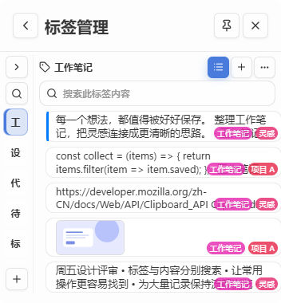
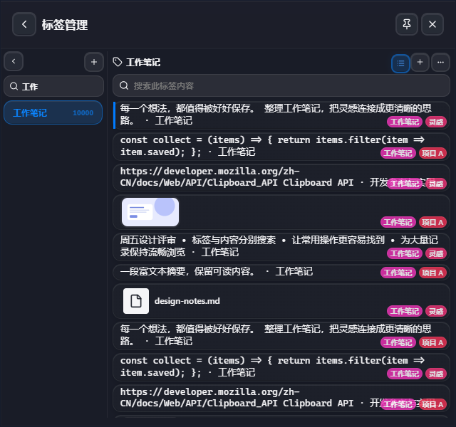

# 标签与主题改造验证

验证基于 `6874106e0095d516d50dc01e15b12f576c1e3e98`，使用 Windows 上的 Edge 浏览器运行实际 React 组件，以及原生 Rust 仓库测试。浏览器数据为合成数据，不读取实际剪贴板历史。

## 问题与改动

旧标签管理器对全部结果执行 `sortedItems.map`，并一次读取完整记录。主题又分别定义标签管理器的卡片、输入、按钮和弹窗，导致相同控件反复覆盖。

这个基线中，Liquid Glass 已关闭标签卡片的 backdrop 模糊，所以不能把此前的 `blur(14px)` 描述直接当作当前所有主题的行为。新版直接复用主页 `ClipboardItem`，保留各主题原有卡片材质，虚拟化让渲染数量随视口而不是总条目数增长；不另外给标签页叠一套卡片模糊。

- 标签页采用设置式左边栏和主页逐行卡片，使用主页面相同的复杂/简洁模式、悬浮按钮和右键菜单。标签导航、内容和主搜索标签选择器均使用 react-virtuoso；每页 60 条，后端拒绝超过 100 条的请求。滚动自动翻页，不提供刷新、加载更多或标签颜色设置。
- 列表只传输有限预览及元数据；全文、富文本和内嵌图片在需要时读取。文本编辑从完整正文开始，避免把预览覆盖到原文。
- 查询放到阻塞任务线程；选择或搜索变化后，丢弃旧请求。短时间内的剪贴板事件合并刷新，颜色变更只刷新标签元数据。
- 20 个公开语义 token 由六套内置主题分别映射；新标签控件消费共享契约。旧控件的材质、几何和状态仍保留现有变量与规则，不宣称整个 CSS 已消除 `!important`。
- 自定义主题只通过有界的本地完整 CSS 包导入，不提供编辑器。导入样式集中持有一张样式表，切回内置时移除；重复应用相同内容不会重建样式表。前后端都解析 CSS 并拒绝外部资源。

## 可复核结果

浏览器试用包含 **10,000 条内容、2,505 个标签**，以应用真实默认 **352 × 380** 窗口为主，另检查较宽窗口。挂载的是视口内的主页卡片与少量预渲染行，不会挂载全部历史：

| 项目 | 结果 |
| --- | --- |
| 默认窗口内容与左栏（24 个主题/模式组合） | 3–8 张卡片、5–6 个标签按钮；卡片高度由内容决定 |
| 主搜索标签下拉 | 6 个选项，完整目录仍可搜索 |
| 初次内容查询 | 1 页；滚动后请求下一页，offset 从 0 到 60 |
| 标签页新增 backdrop 层 | 0；主页卡片保留各主题既有材质 |
| 连续 36 个剪贴板事件 | 合并为 1 次内容重载 |
| 78,018 字符完整编辑 | 未修改保存保留 CRLF 和首尾空白；取消不写入 |

数据库测试另外覆盖：145 条各含 50,000 字符正文的记录，分页不返回全文/HTML；字面搜索、排序和分页边界；普通标签移除保留记录；重命名/移除失败整体回滚。普通标签不能整体改名为系统敏感标签，以免绕过逐条更新所需的加密处理。

「密码」「sensitive」的破坏性删除要求持久化隐私开关明确为 `false`。记录、索引与标签先事务提交，再清理没有存活引用的自有附件；用户原文件、共享附件和符号链接不会被误删。共享引用同时检查富文本 fallback 和普通 HTML 图片；遇到无法完整识别的存活 HTML 资源引用时，保守保留附件。清理失败会同步界面并返回实际错误。开启保护与受保护状态启动时补建两个标签，不恢复已删内容；启动检查使用 IMMEDIATE 事务，避免与独立 CLI 并发写入时升级旧读快照失败。

非标准注释可能让浏览器提前结束注释并显示后续图片，因此引用检查只跳过能确认语义的标准注释。真实仓库删除测试覆盖三种提前闭合注释与正常注释对照；另以 Edge DOMParser 对照生产 Rust 识别器的 3,921 组注释输入，未出现浏览器显示图片而识别器声称无引用的情况。这是该语法边界的验证，不能代替任意 HTML 的完整解析；无法确认时仍保留附件。





六套内置主题分别检查亮/暗模式。对相同组件结构与内容，独立验证在 Edge 中切换改造前后 CSS，比较实际历史行、紧凑列表、设置、菜单、确认框和 Quick Paste 的 432 组计算样式、72 组同机截图，结果无差异；覆盖 Windows/Linux CSS 类与透明度 0/65/100%。这是浏览器中的原有材质/几何对照，不是原生合成器或 WebKitGTK 测试，也不是承诺页面结构没有变化。标签布局、导入入口和设置说明文字清理均属于用户要求的功能改动。

主题生命周期验证包括文件导入、选择、亮暗模式、多窗口同步、跟随系统、重载、导入冲突、完整导出和删除当前主题后的回退。创建/编辑/调色板入口已移除。

审查后的交互验证将主搜索标签下拉与真实全局导航一起挂载，覆盖默认方向键设置开/关、方向键与 Home/End、回车选择、Esc 关闭、空结果、原生导航事件与延迟可见性检查。下拉打开时暂停全局历史导航，关闭后恢复，避免选标签触发历史粘贴。批量标签变更使用无记录载荷的 `clipboard-changed` 通知，主窗与 Quick Paste 重新读取；`clipboard-updated` 保持完整记录载荷契约。

## 静态 CSS 审计

审计整个 `src/styles/**/*.css`，使用 PostCSS AST 计数。每条规则只计一次；带有前缀和不带前缀的 backdrop 声明分别计数。基线的结果是 **2,139 个 `!important`、239 条旧标签管理器规则、58 条非 `none` backdrop 候选规则**。因此不同范围或旧提交得到的「742 / 262」不能直接与全目录数量比较。

| 同一审计范围 | 改造前 | 改造后 |
| --- | ---: | ---: |
| `!important` 声明 | 2,139 | 1,530 |
| 旧 `.themed-tag-manager` 规则 | 239 | 0 |
| 非 `none` backdrop 候选规则 | 58 | 43 |
| 新标签/主题管理样式中的 `!important` | — | 0 |

新增的导入管理和控件状态也包含在改造后统计中。旧控件仍保留自身的优先级规则，需要后续按共享控件逐步迁移；未保留曾为配色导入设计的集中 `!important` 桥接。

### 剩余 `!important` 的来源

1,530 条中，1,510 条保持基线原值，20 条是原有声明改用共享状态变量；没有新增 `!important` 声明。1,530 仅为 `src/styles/` 的统一口径；另有功能目录中原有的 Quick Paste 9 条、区域截图 10 条，不与之前的 2,139 混算。

| 文件/组 | 数量 | 保留原因 |
| --- | ---: | --- |
| `themes/liquid-glass.css` | 498 | 原有玻璃材质、弹窗菜单、设置与控件状态 |
| `themes/scifi.css` | 245 | 原有科幻装饰、表单、标题与控件状态 |
| `themes/macos.css` | 240 | 原有视觉材质、几何、设置与弹窗 |
| `themes/mica.css` / `acrylic.css` | 各 95 | 原有云母/亚克力布局、表单与历史数据标签 |
| `themes/retro.css` | 5 | 原有窗口壳边界 |
| `theme-core/modern-mica-acrylic.shared.css` | 120 | 两种材质共用的标题、表单、历史与按钮样式 |
| `theme-core/macos-dialog.shared.css` | 39 | 原有对话框与应用选择器 |
| 两个 `theme-core/*.shell.shared.css` | 各 20 | 窗口底板、平台边界与透明度 |
| `components/compact-mode.css` | 80 | 紧凑模式覆盖普通布局与间距 |
| `components/compact-preview.css` | 26 | 独立预览窗口边界 |
| `components/queue-bar.css` | 15 | 原有队列条尺寸、背景与交互状态 |
| `components/settings.css` | 10 | 设置布局与表单边界 |
| 其余基础/通用组件 | 22 | 布局溢出、窗口边界、模态交互、历史标签及富文本 |

这些保留规则不是都“必须永远使用重要声明”。移除它们需要把对应控件和主题一起迁移，并逐项验证原有材质与几何；仅删除关键字可能让内联样式或通用规则意外胜出。本次就通过实际界面对照修复了历史标签、类型筛选按钮圆角和紧凑行按钮材质的这类差异。公共语义层、新标签控件和导入管理均不再增加此负担。

运行以下命令查看当前值：

```text
node scripts/audit-theme-css.mjs
node scripts/audit-theme-css.mjs --check
```

已有前端 CI 执行 `--check`：检查十二套内置配色映射、未定义的语义 token、旧标签规则回流，以及新标签/主题管理样式中的 `!important` 和非 `none` backdrop。它不限制全局计数，避免把减少数字本身当作目标。

## 结论的边界

这些结果证明了挂载节点、列表传输量和重复刷新受到控制，逐条增长的旧标签布局已移除。静态声明数既不是合成层数量，也不是 GPU 时间。本次没有使用真实桌面 WebView 的 GPU trace，因此不提供 GPU 百分比、帧率或耗电改善数字。

如需评估原生 GPU 收益，应使用相同机器、窗口、背景、主题、透明度和数据，分别在空闲、连续滚动与标签切换时采集 WebView/系统 trace，再比较合成、绘制、掉帧与内存。不要以浏览器试用的结果替代这一测量。
