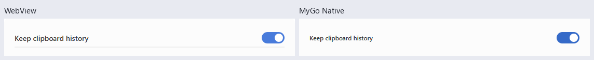
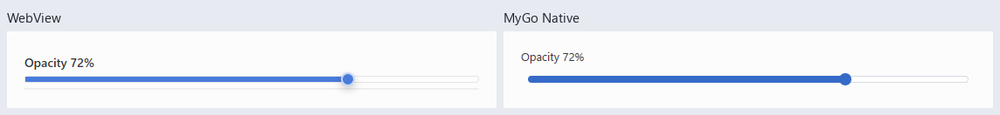
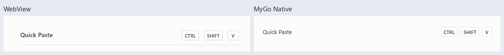
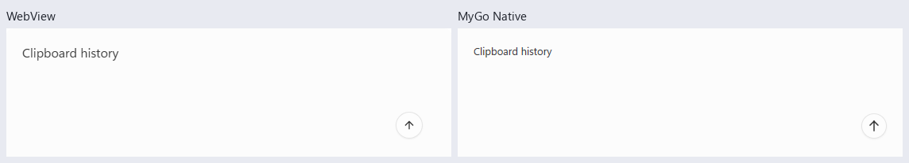
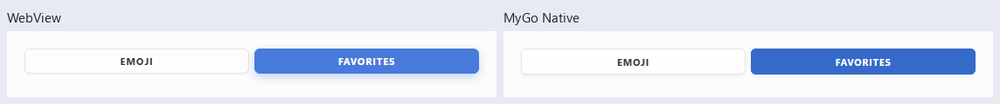
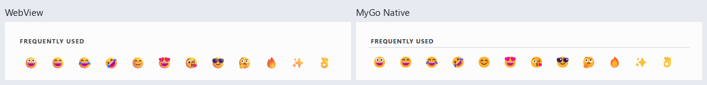

# Deziro React components

The package contains the Web styles and themes used by DezirClip. Components receive their state and actions through props, so an application can supply its own host bindings and data.

Import the shared styles and then load a theme before displaying the interface.

    import "@deziro/ui-react/styles/base.css";
    import "@deziro/ui-react/styles/components/index.css";
    import { loadBuiltinTheme } from "@deziro/ui-react/themes";

    await loadBuiltinTheme("mica");

Apply the corresponding theme and color-mode classes to the HTML and body elements. The available themes are Retro, Mica, Acrylic, Liquid Glass, macOS, and Sci-Fi.

The gallery under showcase uses synthetic data. Run the development server and open the gallery path with theme, mode, fixture and state query parameters to see one component state.

## WebView and MyGo Native comparisons

These examples use the Mica light theme. Each image shows WebView on the left and software-rendered MyGo Native on the right.

### Settings toggle

### Settings slider

### Shortcut binding

### Scroll to top

### Emoji tabs

### Emoji grid

